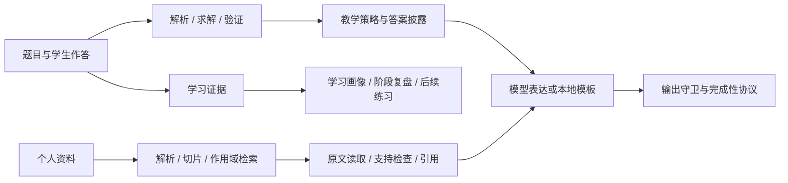

# MathTutor

**一个把“数学教学闭环”和“可追溯资料问答”放进本地桌面端的 K12 数学学习助手。**

MathTutor 不是把大模型套进聊天框。它把题目解析、受限求解与验证、分级提示、作答证据、学习画像、个人资料检索和引用追踪连接成一个可恢复的产品流程。学生可以先尝试、再逐级获得帮助；模型负责表达和整理，应用负责权限、证据、预算、答案披露与数据生命周期。

[项目定位](#项目定位) · [核心功能](#核心功能) · [差异化亮点](#差异化亮点) · [Benchmark](#benchmark-与当前结果) · [快速开始](#快速开始) · [能力边界](#资料问答与能力边界)

## 项目定位

MathTutor 面向希望“学会过程”而不只是“拿到答案”的学生，也面向需要检查资料来源、教学行为和学习依据的家长、教师与开发者。它由 Electron 桌面壳、Next.js 前端和 Python 产品服务组成，运行与打包不依赖 DeepTutor 源码仓库。



模型服务可以替换或不配置。未配置模型时，受支持的本地求解、验证、学习记录和模板辅导仍可使用；生成式讲解与知识综合会降级。

## 核心功能

| 场景 | 功能 |
|---|---|
| 数学辅导 | 对受支持的算术、整式、一元一次/二次方程、二元一次方程组、一元一次不等式和根为有理数的一元二次不等式解析、求解和验证，结合学生作答提供分级提示与反馈；未解决的题目先看过一次提示才能查看完整答案 |
| 函数图像 | 说「画出 y = x^2 - 2x - 3 的图像」或在题目下点「看图像」；坐标由本地服务计算，标出交点、顶点，题目未完成时不标答案点 |
| 初次使用 | 配置模型服务；通过可跳过的 10 道选择题初评获得暂定练习起点 |
| 练习与学习记录 | 保存会话、作答与可信学习事件，提供练习邀请、学习画像（含诊断出的错误概念）和阶段复盘 |
| 自有资料问答 | 导入文本、Markdown 和可提取文字的 PDF，检索相关片段并查看引用原文 |
| 知识库管理 | 管理资料空间、版本、标签、双向链接、检索范围、草稿与笔记，区分当前证据和历史引用凭证 |
| 受控模型工具 | 知识模式下允许检索、读取、验证、草拟、保存笔记和提出练习；普通数学提问时模型可自行调用 `verify_math` 核对结论（每轮最多 4 次）；所有工具均由应用授权并执行 |
| 回答交付 | 讲解中的算式逐一经 `verify_math` 核对，未通过时让模型改正一次，仍错则原处标出；普通聊天按句流式显示，只放出已核对的句子；记录停止原因、token、费用与 PARTIAL 状态 |
| 运行诊断 | 每轮留下不含原文的结构化记录，重启不丢；诊断接口给出失败率、延迟、费用、算式核验与 DKT 调节等指标和告警阈值；可在隔离库中回放失败的对话 |
| 费用与预算 | 按自填单价估算每轮费用，可设每日费用或 token 预算，超出后当天改用本地模板教学 |
| 本地数据管理 | 管理个人记忆、聊天历史、资料和备份，支持已有的备份验证与恢复流程 |

初评采用可解释规则，**不是已经完成目标域校准的 DKT 能力定级**。学习画像以已记录的学习证据为主，也不把阅读、收藏或一句“懂了”自动当成掌握。

## 差异化亮点

没有证据支持“某项能力全球唯一”或“其他产品都没有”。当前可以由源码、测试和评测记录证明的差异，是下面这些机制被组合进同一个可运行产品，而不只是写在演示流程里。

| 差异化设计 | 实际实现 | 对用户的价值 |
|---|---|---|
| 教学与表达分层 | 确定性求解/验证、教学策略、模型表达和输出守卫分开；低提示等级不携带完整答案 | 模型措辞可以变化，答案披露边界仍由产品控制 |
| 先授权、后检索 | owner、会话绑定、启用状态和资料范围在候选检索前进入 SQL/仓储约束 | 不依赖模型“自觉”避开无权读取的资料 |
| 可追溯到原文区间 | 引用绑定资料版本、字符区间、正文哈希和读取凭证；猜测 ID、扩大区间、跨会话读取会被拒绝 | 可以回到模型实际依据的原文，而不是只看到一个文件名 |
| 图像由应用计算 | 函数图像的坐标和标注点由白名单解析器在服务端计算，前端只绘制服务端标记的图像消息；模型不提供坐标 | 图上的交点、顶点不会是模型编造的 |
| 应用授权的模型工具 | 只开放固定 schema 的知识与数学工具；没有 shell、任意 Python、SQL、联网或任意 MCP 权限 | 既能完成“查资料—读原文—核验—保存笔记”，又限制模型执行面 |
| 来源支持与数学正确分开 | quote 要逐字存在，summary 要做支持检查；数学条件另由受限验证器或独立复核判断 | 不把“资料里这样写了”误当成“数学上一定正确” |
| 完成性是一等状态 | 保存 `finish_reason`、步骤/token 预算、续写上下文和最终可见正文；截断、不确定拼接、失败模板保持 PARTIAL/FAILED | 用户能分辨完整回答和可继续恢复的部分回答 |
| 证据驱动的学习画像 | 可信作答事实、明确偏好和待验证假设分开；删除证据会更新投影 | 个性化建议能说明依据，也允许纠错和撤销 |
| 本地产品闭环 | SQLite、资料、会话、备份和系统凭据库均由桌面应用管理；升级前自动备份并支持验证/恢复 | 适合个人长期积累资料，不需要另搭 RAG 服务和数据库 |

### 为什么选择 MathTutor

- 你需要的是**循序提示和作答反馈**，而不是默认直接给答案的通用聊天。
- 你想使用自己的讲义和笔记，并要求回答能回到**真实资料版本与原文区间**。
- 你关心本机数据、跨会话权限、删除语义、备份恢复和模型凭据存放。
- 你希望模型能力可以替换，同时保留本地求解、验证、教学策略和模板降级路径。
- 你需要可复现的工程证据，并愿意接受“未测就是未测、AI 初审不是人工验收”的质量口径。

如果你需要扫描 PDF OCR、已经签名并完成安装/卸载验收的公开安装包，或经过正式人工 gold、独立 holdout 和重复实验验证的自然语言数学正确率，当前版本还不满足这些要求。

## Benchmark 与当前结果

### 我们对比的 benchmark 是什么

项目当前**没有**把自己与 ChatGPT、Khanmigo 或其他商业产品做公开的同题 head-to-head，也没有参加外部教育产品排行榜。因此 README 不使用“优于某竞品”的结论。现有 benchmark 比较的是本项目不同检索/工具链版本，以及当前生产链在固定语料上的回归表现：

1. **Official RAG easy set**：6 份中文数学资料、12 个真实切片、9 个查询，覆盖规范术语、口语改写、公式、中英/LaTeX 混排和近义干扰。
2. **RAG hard set**：17 个切片、5 个查询，强制制造多切片竞争、上下文扩展、同节干扰和跨章节边界。
3. **权限与引用探针**：覆盖未绑定资料、跨 owner、禁用/删除、空 scope、非法区间、跨会话读取和历史引用凭证。
4. **Knowledge 链路对比**：使用相同 5 个查询，对比冻结旧链、新链原生 tools 和新链 JSON 兼容协议，核对真实工具读取与笔记保存，而不是只比较回答措辞。
5. **真实模型开发回归**：固定 Provider、模型、问题、资料与预算，逐声明区分证据支持、数学正确性、引用归属和任务完成；AI 复核始终标为 provisional。

官方检索 benchmark 走真实生产路径，而不是平行 mock：

```text
真实资料 → SQLite 摄入/切片/FTS → DocumentIndexManager
        → ConversationRetrievalOrchestrator → ProductionReranker
        → ContextExpander → EvidencePack
```

### 已记录的结果

| 评测组 | 样本 | 结果 | 应如何解读 |
|---|---:|---|---|
| Easy retrieval | 9 queries | R@5 1.000、MRR@5 1.000、nDCG@5 1.000、Hit@1 1.000 | 语料太小且区分度不足，只能作为严重回归地板 |
| Hard retrieval | 5 queries / 17 chunks | R@5 1.000、MRR@5 0.900、nDCG@5 0.949、Hit@1 0.800 | 比 easy set 更有竞争，但样本仍小 |
| Hard context | 5 queries | Context Precision 0.344、Context Recall 1.000、Noise Ratio 0.656 | 召回完整但带入较多无关上下文，仍有明确优化空间 |
| Citation attribution | 4 claim cases / 5 links | Precision 0.875、Recall 1.000 | 是固定小样本的引用归属，不是回答 Faithfulness |
| Historical receipts | 1 合法 / 4 非法探针 | 合法读取 1/1；未授权拒绝 4/4 | 分别验证可用性与拒绝能力 |
| Knowledge old vs new | 5 queries | 三组命中均为 4/5；旧链读取 0、保存 0，新链两种协议均读取 2 个来源并新增 1 篇笔记 | 证明工具任务闭环，不证明真实回答质量提升 |
| 固定多轮辅导评测（自动） | 15 个多轮场景 / 184 项检查 | 模板教学 15/15 通过，六个维度均为 1.0，发布门通过 | 全部由规则和本地验证器自动评分，**没有人工评分**；只证明答案边界、证据分流和算式核验没有走样，不证明讲解质量；真实模型尚未跑过。见 [评测说明](docs/eval/TUTOR_MULTITURN_EVAL.md) |
| 真实回答 AI 初审 | 14 answers / 57 claims | provisional Faithfulness macro 0.520、关键内容覆盖 0.571、任务完成 6/14 | 开发质量为 **FAIL**；human review 仍为 **PENDING** |

Context Redundancy 的记录值为 0.913，但 hard fixture 在检索前已经有 0.831 的 4-gram 重复率，因此不能把 0.913 直接解释为产品生成了大量重复内容。检索指标、引用合法性、来源支持和数学正确性是四个不同维度，不能互相替代。

完整定义、分子/分母、语料版本、评分器、限制与复现命令见 [RAG 评测报告](docs/RAG_EVALUATION.md)。当前正式语义验收仍为 **INSUFFICIENT_EVIDENCE**。

## 版本与发布状态

当前源码版本为 **0.5.0**，数据库 migration head 为 **023**。源码版本、安装包工程验证和真实回答质量分别记录。

### 0.5.0（当前正式版）

- 未解决的题目要先看过一次提示，才能查看完整答案；已答对或已看过答案的题目仍可随时回看。
- 学习画像的「活跃错误概念」按作答诊断出的错误规则统计，同一技能之后独立答对即视为解除；数据导出列出同样的错误概念。
- 新增函数图像：服务端计算坐标，前端用 canvas 绘制。题目未完成时不标出零点和交点，看过这道题的图像后再作答记为「受助」。
- 数据库结构不变，从 0.4.5 升级无需数据迁移。完整说明见 [CHANGELOG](CHANGELOG.md)。

### 发布记录

| 版本 | 内容 | 安装包（均 **未签名**） | SHA-256 |
|---|---|---|---|
| [`v0.5.0`](https://github.com/coscatld/MathTutor/releases/tag/v0.5.0) | 先看提示再看答案、错误概念统计、函数图像 | `MathTutor-0.5.0-mac-arm64.dmg` | `3b7cd4da265e7a74a41b7a3a3a4fdbaf2bc0a71c55462e612a9e48dfd9c45861` |
| | | `MathTutor-0.5.0-win-x64.exe` | `ab22ece2ee97b15a861ad81bb15a891c9f0eafadd4cbf9359519249bee27ac3a` |
| [`v0.4.5`](https://github.com/coscatld/MathTutor/releases/tag/v0.4.5) | 页面风格与视觉焕新，不改教学策略 | `MathTutor-0.4.5-mac-arm64.dmg` | `f0f8e7f7c1d37ac57a9143fe59494c29c9433a5ca14cddb3634e119d573003ff` |
| | | `MathTutor-0.4.5-win-x64.exe` | `b20771b1aa7a591d70a77cb122e0bb592d822074dd27844058fcad4abd37c14e` |

两个版本的 macOS 安装包都通过了打包后冒烟测试（启动、作答、重启、备份恢复、退出清理）；Windows 安装包由 GitHub Actions 构建，未在 Windows 实机完成安装/卸载验收。macOS 首次打开需在「系统设置 → 隐私与安全性」中允许，Windows 可能出现 SmartScreen 提示。

### 更早的版本

- 0.4.4 安装包附带已训练的 DKT（ASSISTments 2009，seed 29）。映射得上的技能用这份权重量出一个概率，并据此调整下一步提示和练习难度；概率不是掌握度，映射不上的技能仍为空。见 [0.4.4 发布说明](docs/RELEASE_0.4.4.md)。
- 0.4.3 是界面版本，[`v0.4.3`](https://github.com/coscatld/MathTutor/releases/tag/v0.4.3) 以 pre-release 发布，附未签名的 Windows x64 工程安装包。见 [0.4.3 发布说明](docs/RELEASE_0.4.3.md)。
- 0.4.2 的 RAG 集成由 [PR #2](https://github.com/coscatld/MathTutor/pull/2) 合并；`v0.4.2` Release 页面没有安装包 assets。

真实语义质量仍有历史失败项和待人工复核项，离线回放通过不等于真实模型质量通过。下载请查看 [GitHub Releases](https://github.com/coscatld/MathTutor/releases)，并用上表的 SHA-256 核对；旧版本产物不能代表当前源码功能。

## 快速开始

### 环境准备

- 开发系统：Windows、macOS 或 Linux。
- Python：建议使用 **3.12**；项目声明支持 `>=3.11,<3.14`。
- Node.js 与 npm：本地 Windows 打包已验证 **Node.js 24.19.0**；现有源码 CI 使用 Node.js 20。安装依赖使用仓库锁文件和 `npm ci`。

在项目根目录创建 Python 虚拟环境：

```bash
python -m venv .venv
```

Windows PowerShell 激活方式：

```powershell
.\.venv\Scripts\Activate.ps1
```

macOS / Linux 激活方式：

```bash
source .venv/bin/activate
```

安装后端开发依赖：

```bash
python -m pip install -e ".[dev]"
```

### 方式一：浏览器开发模式

在已激活虚拟环境的项目根目录启动后端：

```bash
python -m mathtutor
```

另开终端，进入项目的 `web` 目录启动前端：

```bash
cd web
npm ci
npm run dev
```

默认后端地址为 `http://127.0.0.1:8001`，浏览器访问 `http://127.0.0.1:3000`。

本机默认使用 loopback 单用户流程，无需注册或登录。首次进入时配置模型服务商、模型与 API Key，也可跳过模型配置，使用模板教学。配置后按页面引导完成或跳过初评，进入工作台。远程或网络部署的认证边界不等同于本机默认模式。

### 方式二：源码版桌面应用

完成 Python 依赖安装后，从项目根目录执行：

```bash
cd web
npm ci
npm run build
cd ../desktop
npm ci
npm start
```

桌面壳使用项目根目录的 `.venv`，自动启动 Python 服务、Verifier Worker 和 Next.js 前端，并选择本机随机端口。无需同时保留浏览器开发模式的两个服务进程。

## 资料问答与能力边界

资料问答的基础路径为：**导入资料 → 本地解析与切片 → 检索与上下文组装 → 读取证据 → 回答与引用**。检索由共享 orchestrator 组织，工具读取受会话权限、资料版本和原文区间约束。

| 能力 | 当前边界 |
|---|---|
| 文档解析 | 保证文本、Markdown 与 pypdf 可读取 PDF 的基础解析；扫描件 OCR 未实现 |
| 检索 | 默认可用基线为词法检索；Embedding 是可选依赖，不是桌面包保证包含的能力 |
| PDF 增强解析 | `pdf-rich` 为可选依赖；未安装时使用基础解析路径 |
| 引用与来源 | 可读取合法范围的来源及历史引用凭证；来源合法不等于内容支持回答 |
| Knowledge 摘要 | 产品工具路径包含证据读取与支持检查；生产支持检查不能替代独立评审 |
| 数学验证 | 仅覆盖受限求解器和验证器支持的表达式、条件与步骤；超出能力不能视为已验证 |
| 自动续写 | 对受支持的接缝保留连续正文；真实截断、不确定拼接等仍可能返回 PARTIAL，可按界面继续处理 |

需要增强依赖时，可在源码环境中按需安装：

```bash
python -m pip install -e ".[embedding]"
python -m pip install -e ".[pdf-rich]"
```

安装额外依赖不等于模型已配置、向量索引已建立或对应质量已通过验证。模型正常停止、引用操作通过，以及部分算式被标为 `VERIFIED`，都不能扩大解释为整篇自然语言回答数学正确。来源本身含错时，也必须区分“来源支持”和“数学正确”。

## 数据、模型配置与备份

应用的数据库、上传资料和备份保存在本机。**使用外部模型服务时，请求中的问题、上下文和相关资料片段仍可能发送给所配置的服务商**，不能将本地存储理解为全程离线。

- 源码后端默认使用当前目录下的 `data/`；可通过 `MATHTUTOR_DATA_ROOT` 指定数据目录，或通过 `MATHTUTOR_DB_PATH` 指定数据库路径。
- 桌面版使用独立的用户数据目录，退出应用会停止本地子进程，并保留学习资料和历史。
- API Key 通过 `SecretStore` 管理；macOS 使用 Keychain，Windows 使用 Credential Manager。
- 数据库加密可选（默认关闭）：在「设置 → 高级 → 数据加密」开启后，下次启动时把本机数据库转换为 SQLCipher 加密库，转换前后都做完整性和行数校验，失败保持原样。密钥只存在系统钥匙串 / 凭据管理器中。只要系统密钥存储可用，备份文件始终加密；请在同一处「显示恢复密钥」并妥善保存，钥匙串条目丢失时恢复备份需要它。导入的资料原文件仍以普通文件保存在数据目录，依赖系统全盘加密。Windows 上的加密转换尚未在实机验证。不要把凭据、私人配置、用户数据库或原始模型请求日志提交到仓库。
- 0.5.0 的数据库 migration head 为 **023**（自 0.4.2 起未变）。升级前使用应用内备份功能创建并验证备份，再正常退出应用。
- 恢复旧备份可能缺少之后产生的新资料和聊天，请先保存当前数据。代码回滚不会自动恢复数据库；不要手动删除活跃数据库的 WAL/SHM 文件。

## 开发与测试

安装 Python 开发依赖，以及 `web`、`desktop` 的 npm 依赖后，在项目根目录运行：

```bash
python scripts/check.py
```

该入口执行后端与 Python 桌面测试、Web 测试、前端生产构建和 Node.js 桌面契约测试。没有准备目标平台的独立 Python 运行时时，发行运行时验证会显示跳过，不能据此宣布安装包验证通过。

评测分别记录检索、可见上下文、引用权限、语义支持、数学正确性、任务完成和性能成本。`PROVISIONAL_AI` 表示 AI 初审，不能写成人工验收；`BUDGET_BLOCKED` 表示真实调用未执行，不是质量通过。具体口径与结果见 [RAG 评测报告](docs/RAG_EVALUATION.md)。

```text
src/mathtutor/   Python 产品服务、教学流程、检索与验证
web/            Next.js 工作台
desktop/        Electron 桌面壳、运行时与打包脚本
tests/          自动化测试与测试夹具
scripts/        工程检查、评测与回放入口
docs/           架构、实现、评测与版本文档
```

测试夹具和评测资料不作为用户知识库的默认教学内容。

## 构建安装包

本地构建默认未签名。公开发行需满足现有工作流的签名要求，并对最终产物重新进行包外验证；构建成功不等于正式发布。三平台源码 CI 通过不能替代各平台安装包的启动、迁移、签名或安装/卸载验证，平台约束见 [桌面发行设计](docs/ADR_DESKTOP_DISTRIBUTION.md)。

### Windows x64

Windows 安装包不能在 macOS 上构建。可以在 GitHub Actions 手动运行 `windows-installer.yml`，从产物 `MathTutor-windows` 下载；也可以在 Windows PowerShell 中从项目根目录执行：

```powershell
Set-Location web
npm ci
Set-Location ..\desktop
npm ci
npm run package:win
```

脚本构建 Next.js standalone 前端，准备并验证独立 Python 运行时，然后生成 NSIS 安装器：

```text
desktop/dist/MathTutor-0.5.0-win-x64.exe
```

使用 Node.js 22 时，项目路径含中文等非 ASCII 字符会让运行时校验中的 `fs.cpSync` 崩溃（无错误输出）。请从纯英文路径构建，或向 `desktop/scripts/build-windows.ps1` 传入英文路径的 `-RuntimePath`，或改用已验证的 Node.js 24.19.0。下载后可检查摘要：

```powershell
Get-FileHash -Algorithm SHA256 .\MathTutor-0.5.0-win-x64.exe
```

### macOS（Apple 芯片）

macOS 安装包需要一个可重定位、带 numpy 的独立 Python 运行时（python-build-standalone CPython 3.11）。用 `desktop/scripts/prepare-macos-python-runtime.py` 准备后，指向它构建并冒烟：

```bash
export MATHTUTOR_PYTHON_RUNTIME=$PWD/.runtime/<python-runtime-dir>
(cd web && npm ci && npm run build)
npm ci --prefix desktop
npm run package:mac:unsigned --prefix desktop
npm run smoke:packaged:mac --prefix desktop
shasum -a 256 desktop/dist/MathTutor-0.5.0-mac-arm64.dmg
```

普通虚拟环境不可重定位，不能作为打包运行时。下载 Electron 较慢时，可设置 `ELECTRON_MIRROR` 与 `ELECTRON_BUILDER_BINARIES_MIRROR` 使用镜像。

## 文档导航

| 文档 | 内容 |
|---|---|
| [CHANGELOG](CHANGELOG.md) | 各版本改动与升级说明 |
| [固定多轮辅导评测](docs/eval/TUTOR_MULTITURN_EVAL.md) | 自动评分的多轮场景、六维度、发布门与最近结果 |
| [初评与选择题](docs/INITIAL_ASSESSMENT.md) | 首次评估、跳过与恢复、练习起点的含义 |
| [RAG 架构](docs/RAG_ARCHITECTURE.md) | 共享检索、上下文与证据工具路径 |
| [知识工作台](docs/KNOWLEDGE_WORKBENCH_DELIVERY.md) | 资料管理、问答与引用功能 |
| [RAG 实施报告](docs/RAG_IMPLEMENTATION_REPORT.md) | 实现范围、工程证据与遗留事项 |
| [RAG 评测报告](docs/RAG_EVALUATION.md) | 指标口径、测试结果和验收限制 |
| [0.4.2 离线数学修复](docs/OFFLINE_MATH_REPAIR_042.md) | 数学条件、退化情况与保存响应回放 |
| [桌面发行设计](docs/ADR_DESKTOP_DISTRIBUTION.md) | 平台运行时、打包和交付约束 |

## 许可证

项目采用 [Apache License 2.0](LICENSE)。第三方组件说明见 [THIRD_PARTY_NOTICES.md](THIRD_PARTY_NOTICES.md)。
