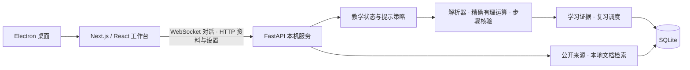

# MathTutor 数迹

MathTutor 是一款桌面数学学习软件。写下自己的一步推导，看看从哪一行开始出了问题；带着概念上的疑问，可以对照百科、教材或自己的讲义，再回到原文核对。中英文界面均可使用。

**[在线试一道方程](https://coscatld.github.io/MathTutor/zh/demo/)** · [产品官网](https://coscatld.github.io/MathTutor/zh/) · [第一次使用](https://coscatld.github.io/MathTutor/zh/docs/user/quick-start/) · [Try it in English](https://coscatld.github.io/MathTutor/en/demo/)

## 下载与安装

| 平台 | 安装包 | 首次使用 |
| --- | --- | --- |
| macOS · Apple Silicon | [下载 DMG](https://github.com/coscatld/MathTutor/releases/download/desktop-20261125/MathTutor-mac-arm64.dmg) | 打开磁盘映像，将 MathTutor 拖入“应用程序”。 |
| Windows 10/11 · x64 | [下载 EXE](https://github.com/coscatld/MathTutor/releases/download/desktop-20261125/MathTutor-windows-x64.exe) | 打开安装程序，按向导完成安装。 |

打开应用即可离线练习。设置里可以切换语言、连接模型或启用知乎。安装步骤和文件校验值见[安装指南](https://coscatld.github.io/MathTutor/zh/docs/user/installation/)与[发布记录](https://github.com/coscatld/MathTutor/releases/tag/desktop-20261125)。

## 学一道题

- **自己写一步。** 试着解 `2x+3=7`。写下 `x+1=3`，应用会认可这次等价变形，等你继续解出 `x`。也可以每行写一步，查看首个出错或尚待核验的位置。输入框里的 ∑ 可插入分数线、平方、括号和不等号。
- **按需获得帮助。** 卡住时可以要一个提示，再用新题检验自己能否独立完成。作答时可粘贴草稿图供自己对照，需要讨论图片时再切换到图片提问。
- **回看证据，安排复习。** 学习画像能回到当时的题目、作答和提示记录。支持的技能会在第 1、3、7 天安排变式复测，帮助区分当场订正与隔天独立作答。


## 探索一个问题

打开侧栏的「知识探索」，输入一个概念，例如「导数」。默认检索 Wikipedia 和 Wikibooks，匹配时还会提供开放教材的原文摘录。每条材料标明来源类型，可以对照定义、例子与适用条件，打开原文复核。选择本地资料可检索自己的文字版 PDF 和讲义。知乎问答可在设置中连接。[知识探索指南](https://coscatld.github.io/MathTutor/zh/docs/user/knowledge-exploration/)

## 开发者入口



`web/` 是学习工作台，`desktop/` 启动本机服务。后端的 `solving/` 负责解析、求解和独立核验，`learning/` 判定学生作答，`application/` 编排教学，`repositories/` 保存状态。模型可据核验记录写提示。[后端源码](src/mathtutor/) · [架构说明](https://coscatld.github.io/MathTutor/zh/docs/developer/architecture/)

### 在本地运行

使用 Python 3.11–3.13 和 Node.js 24。克隆仓库后，在根目录建立并激活 Python 虚拟环境，在第一个终端运行以下命令。

```sh
python -m pip install -e ".[dev]"
python -m mathtutor
```

另开终端，在同一仓库根目录启动工作台。

```sh
npm --prefix web ci
npm --prefix web run dev
```

打开 `http://127.0.0.1:3000`，后端默认监听 `127.0.0.1:8001`。提交改动前可运行 `python scripts/check.py`。[贡献指南](CONTRIBUTING.md)

### 评测结果

| 项目 | 数据与比较 | 结果 |
| --- | --- | --- |
| 逐行核验 | 34 个手写开发案例，同时核对判定、首个问题行及指定诊断 | 从 8/34 到 34/34。22 个不应满分的案例中，错误满分从 5 降到 0。[案例](benchmarks/steps/cases.json) · [复跑脚本](benchmarks/steps/evaluate.py) |
| 多轮辅导 | 模板模式，真实对话协议，16 个固定场景 | 16/16 场景通过。同一批 45 个数学检查项中，可核验项从 27 增至 30，当前 30 项均通过。[评测方法](docs/eval/TUTOR_MULTITURN_EVAL.md) |
| 提示中提前给出答案 | 固定种子 7，向提示防护注入 660 条含答案的留出候选与 360 条合规对照 | 拦截 572/660，放过 88/660；合规对照误拦 0/360。[原始分项](docs/experiments/dual_channel_ablation_seed7.json) |
| 错误模式辨别 | 固定种子 0，有符号减法，三个问题内辨别已知规则的 200 个合成回合 | 主动选题 200/200，随机选题 165/200，固定顺序 43/200。[分项指标](docs/research/learning-loop-20261111/metrics.json) |
| 四套公开数学辅导基准 | 两次 MathTutor 构建使用同一 DeepSeek Flash，独立模型评审 191 条教学回应 | 六项标准平均满足率从 78.36% 到 88.22%。包含客观任务的完整分析集为 311 条。[实验报告](docs/eval/OPEN_SOURCE_BENCHMARK_20261016.md) · [评分协议](benchmarks/opensource/PROTOCOL.md) |

逐行核验可用 `python benchmarks/steps/evaluate.py` 复现。表中每项给出了各自的样本和比较对象。真实学生第 7 天独立迁移通过率尚待随访测量。[更多复现命令](https://coscatld.github.io/MathTutor/zh/docs/developer/testing-evaluation/)

## 许可证

MathTutor 采用 Apache-2.0 许可证。资料摘录与第三方组件各自保留署名和许可。[许可证](LICENSE) · [第三方声明](THIRD_PARTY_NOTICES.md)
