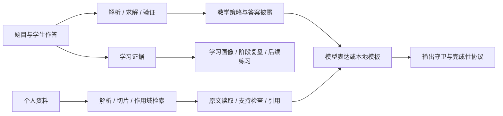
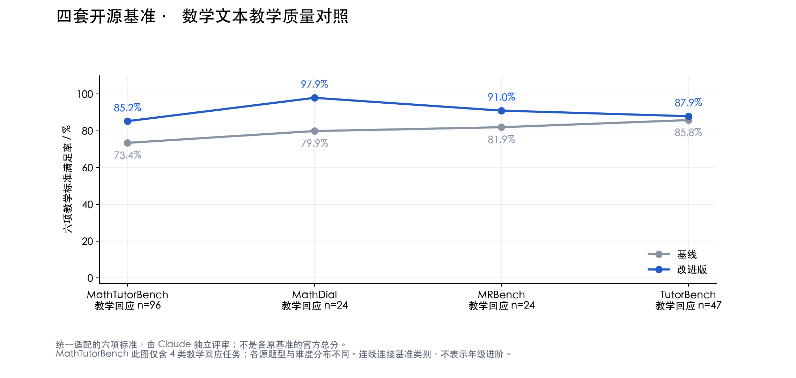

# MathTutor——基于学习过程追踪与可验证解题的开源数学智能辅导系统

[](LICENSE) [](https://github.com/coscatld/MathTutor/actions/workflows/cross-platform.yml) [](https://huggingface.co/datasets/coscatld/mathtutor)

**官网：** [https://coscatld.github.io/MathTutor/](https://coscatld.github.io/MathTutor/) · [中文](https://coscatld.github.io/MathTutor/zh/) · [English](https://coscatld.github.io/MathTutor/en/) · [Docs](https://coscatld.github.io/MathTutor/zh/docs/) · [Download](https://coscatld.github.io/MathTutor/zh/download/)

站点源码在 [`site/`](site/)，由 GitHub Actions 静态发布到 GitHub Pages。

**面向小学至高中的本地数学辅导系统，连接学习过程、可追溯资料与有明确边界的解题核验。**

MathTutor 把题目解析、受限求解与验证、分级提示、作答证据、学习画像、个人资料检索和引用追踪连接成一个可恢复的产品流程。学生可以先尝试、再逐级获得帮助；模型负责表达和整理，应用负责权限、证据、预算、答案披露与数据生命周期。

**下载软件：** [macOS Apple Silicon](https://github.com/coscatld/MathTutor/releases/download/v0.7.1/MathTutor-0.7.1-mac-arm64.dmg) · [Windows x64](https://github.com/coscatld/MathTutor/releases/download/v0.7.1/MathTutor-0.7.1-win-x64.exe) · [下载与校验记录](https://github.com/coscatld/MathTutor/releases) · [Mac 安装说明](docs/MACOS_INSTALLATION.md)

**近期改进：** 设置支持中文与 English；备份恢复、配置保存和记忆编辑保留失败后的恢复路径；教学统计区分独立、受助与看过选项的作答；数学计算、模型工具和消息队列都有明确预算。下文介绍当前源码实现，安装包的具体内容以其随附构建与验收记录为准。

[项目定位](#项目定位) · [核心功能](#核心功能) · [差异化亮点](#差异化亮点) · [Benchmark](#benchmark-与当前结果) · [Hugging Face](https://huggingface.co/datasets/coscatld/mathtutor) · [快速开始](#快速开始) · [能力说明](#资料问答与能力说明)

| 你想做什么 | 从这里开始 |
|---|---|
| 安装使用 | [下载页](https://github.com/coscatld/MathTutor/releases)，查看实际安装文件、校验摘要及平台验收记录；桌面包内置 Python / Node |
| 了解或复现评测 | [Hugging Face 评测工具与阶段结果](https://huggingface.co/datasets/coscatld/mathtutor)及下文的指标说明 |
| 导入自己的资料和插件 | [社区使用指南](docs/COMMUNITY.md)，资料和插件分别导入，代码插件需明确确认信任 |
| 贡献题库或插件 | [贡献指南](CONTRIBUTING.md)、[题库投稿](docs/QUESTION_PACK_CONTRIBUTION.md)、[插件快速入门](docs/PLUGIN_QUICKSTART.md) |
| 开发核心功能 | [代码导航](docs/OPEN_SOURCE_REPOSITORY_MAP.md)和[源码运行方法](#快速开始) |

## 项目定位

MathTutor 面向希望“学会过程”而不只是“拿到答案”的学生，也面向需要检查资料来源、教学行为和学习依据的家长、教师与开发者。它由 Electron 桌面壳、Next.js 前端和 Python 产品服务组成，运行与打包不依赖 DeepTutor 源码仓库。

## 与 DeepTutor 的关系

MathTutor 是在 [DeepTutor](https://github.com/HKUDS/DeepTutor) 数学辅导能力上的二次开发与独立抽取：教学闭环、学习证据、本地核验和桌面分发在本仓库继续演进，运行时不再导入 `deeptutor` 包。许可证仍为 Apache-2.0，版权页保留 **Copyright 2025 Data Intelligence Lab, The University of Hong Kong**。第三方概念与 DKT 权重说明见 [THIRD_PARTY_NOTICES.md](THIRD_PARTY_NOTICES.md)。



模型服务可以替换或不配置。未配置模型时，受支持的本地求解、验证、学习记录和模板辅导仍可使用；生成式讲解与知识综合会降级。

## 核心功能

| 场景 | 功能 |
|---|---|
| 数学辅导 | 对受支持的算术、整式、一元一次/二次方程、二元一次方程组、一元一次不等式和根为有理数的一元二次不等式解析、求解和验证，结合学生作答提供分级提示与反馈；未解决的题目先看过一次提示才能查看完整答案 |
| 函数图像与数形结合 | 说「画出 y = x^2 - 2x - 3 的图像」或在题目下点「看图像」；也能画隐式曲线（椭圆、双曲线、圆等）、参数与极坐标曲线、不等式区域、点、线段、多边形、切线，参数带滑块和播放，动点留轨迹，距离 / 角度 / 面积等读数实时更新（如「演示椭圆 x^2/4+y^2/3=1 上的动点 P(2cos t, √3 sin t) 到焦点 F(1,0) 的距离」）。表达式由白名单解析器编译，坐标由应用计算；配置模型后，复杂描述可由模型提出定义，标注为未核验的示意图 |
| 题库 | 小学一年级至高三共 383 个知识点、801 道原创课程题（附默认隐藏的参考答案与解题说明），另有 353 道支持本地步骤核验的练习与数形结合演示；可按学段和年级查看，跨年课程同时可查 |
| 学习记忆 | 主动保存或确认的偏好、目标和备注可供普通聊天与结构化模型辅导参考；支持修改、停用、确认和删除，当前请求优先，记忆不计作掌握度。离线模板暂不按任意文字偏好调整 |
| 界面语言 | 在「设置 → 通用 → 界面语言」选择中文或 English，立即生效并在本机保存；题目、笔记和对话原文保持不变 |
| 初次使用 | 配置模型服务；通过可跳过的 10 道选择题初评获得暂定练习起点；暂缓后可从学习记录继续 |
| 练习与学习记录 | 保存会话、作答与可信学习事件，提供练习邀请、学习画像（含诊断出的错误概念）和阶段复盘 |
| 自有资料问答 | 导入文本、Markdown 和可提取文字的 PDF，检索相关片段并查看引用原文 |
| 知识库管理 | 按文件夹管理题库与 Markdown 笔记，编辑、保留版本、标签和双向链接；导入共享题库 JSON / 资料库 ZIP，导出当前正文再分享。当前回答的参考范围统一在“对话资料”选择 |
| 社区导入 | “发现资源”导入个人文件夹、Markdown、TXT 和题库；“我的插件”单独导入并管理插件，两类文件分别处理 |
| 社区插件 | 导入教学插件或 Python / TypeScript 代码包，明确同意后启用；支持真实运行、保存结果、停用、升级与卸载 |
| 斜杠命令 | 在对话中输入 `/` 选择已启用插件，补充参数后发送；宿主执行插件并将真实结果提供给当前模型 |
| 插件开发 | 独立开发者指南提供插件编写、调试、打包与发布步骤；用户在社区直接导入开发者分享的文件 |
| 受控模型工具 | 知识模式下允许检索、读取、验证、草拟、保存笔记和提出练习；普通数学提问时模型可自行调用 `verify_math` 核对结论，并按「画图技能」调用 `draw_scene` 在画布上配图；所有工具均由应用授权并执行 |
| 画图技能 | 模型配图一律通过 `draw_scene` 交给应用在 canvas 上绘制，约束写在 `skills/canvas_drawing/SKILL.md`；字符画、Markdown 图片、Mermaid / TikZ / SVG / 绘图代码会被移除并改为画布作图 |
| 回答交付 | 讲解中可解析的算式经 `verify_math` 核对；条件受限或超出语法范围的推理标为未核验，被反驳时让模型改正一次，仍错则原处标出；记录停止原因、token、费用与 PARTIAL 状态 |
| 运行诊断 | 每轮留下不含原文的结构化记录，重启不丢；诊断接口给出失败率、延迟、费用、算式核验与 DKT 调节等指标和告警阈值；可在隔离库中回放失败的对话 |
| 费用与预算 | 按自填单价估算每轮费用，可设每日费用或 token 预算，超出后当天改用本地模板教学 |
| 本地数据管理 | 管理个人记忆、聊天历史、资料和备份，支持已有的备份验证与恢复流程 |

初评采用可解释的规则题组给出练习起点。学习画像以已记录的学习证据为主：独立、受助、看答案后的作答分开统计，阅读、收藏或一句“懂了”只作为自我报告。未能定位具体技能的多技能错误保留为整题观察，可回到原作答查证；新题邀请核对完整保留历史，复习重做单独标明。

## 差异化亮点

下面这些机制都在同一个可运行产品中实现，每一项都有对应的源码、自动化测试和评测记录。

| 差异化设计 | 实际实现 | 对用户的价值 |
|---|---|---|
| 教学与表达分层 | 确定性求解/验证、教学策略、模型表达和输出守卫分开；低提示等级不携带完整答案 | 模型措辞可以变化，答案披露边界仍由产品控制 |
| 先授权、后检索 | owner、会话绑定、启用状态和资料范围在候选检索前进入 SQL/仓储约束 | 不依赖模型“自觉”避开无权读取的资料 |
| 可追溯到原文区间 | 引用绑定资料版本、字符区间、正文哈希和读取凭证；猜测 ID、扩大区间、跨会话读取会被拒绝 | 可以回到模型实际依据的原文，而不是只看到一个文件名 |
| 图像由应用计算 | 函数、曲线、区域、动点等图形的表达式由白名单解析器编译，坐标、交点和读数由应用计算，前端只绘制服务端标记的图像消息 | 图上的交点、顶点和读数来自计算，不来自模型的描述 |
| 区分算式核验范围 | 可解析的算式经 `verify_math` 核对；未绑定原题的条件推理不冒充完整证明；失败改写不能用空洞回退替换原解答 | 区分已核对、无法核对与被反驳的内容，明确可信范围 |
| 应用授权的模型工具 | 只开放固定 schema 的知识与数学工具；没有 shell、任意 Python、SQL、联网或任意 MCP 权限 | 既能完成“查资料—读原文—核验—保存笔记”，又限制模型执行面 |
| 来源支持与数学正确分开 | quote 要逐字存在，summary 要做支持检查；数学条件另由受限验证器或独立复核判断 | 不把“资料里这样写了”误当成“数学上一定正确” |
| 完成性是一等状态 | 保存 `finish_reason`、步骤/token 预算、续写上下文和最终可见正文；截断、不确定拼接、失败模板保持 PARTIAL/FAILED | 用户能分辨完整回答和可继续恢复的部分回答 |
| 证据驱动的学习画像 | 可信作答事实、明确偏好和待验证假设分开；删除证据会更新投影 | 个性化建议能说明依据，也允许纠错和撤销 |
| 本地产品闭环 | SQLite、资料、会话、备份和系统凭据库均由桌面应用管理；升级前自动备份并支持验证/恢复 | 适合个人长期积累资料，不需要另搭 RAG 服务和数据库 |

### 为什么选择 MathTutor

- 你需要的是**循序提示和作答反馈**，而不是默认直接给答案的通用聊天。
- 你想使用自己的讲义和笔记，并要求回答能回到**真实资料版本与原文区间**。
- 你关心本机数据、跨会话权限、删除语义、备份恢复和模型凭据存放。
- 你希望模型能力可以替换，同时保留本地求解、验证、教学策略和模板降级路径。
- 你看重可复现的工程证据：固定多轮评测、发布门、逐轮诊断记录和失败回放都在仓库里，可以自己跑一遍。
- 你想用图形理解数学：曲线、区域、动点和读数可以直接在对话里拖动和播放。

## Benchmark 与当前结果

评测工具与阶段结果同时发布在 **[Hugging Face：coscatld/mathtutor](https://huggingface.co/datasets/coscatld/mathtutor)**，包含四基准适配、运行与评分工具、离线复现说明、费用控制及 Matplotlib 折线图。该仓库明确保留历史被测提交和未完成范围，不能当作当前所有功能的全量成绩；原始第三方题库未重新分发，来源和许可见其仓库说明。

2026-10-16新增K12内部基准：192道题，开发与封存测试各96道。同一DeepSeek模型经真实产品入口完成两轮agent改进后，封存测试严格答案通过率从87/96（90.6%）升至93/96（96.9%），高中从35/42（83.3%）升至40/42（95.2%）。初中有1题回退，保留全部失败与评分争议。指标包含所求量和格式约定，有限样本不代表所有年级或高考题的通用表现；方法与边界见[K12基准记录](docs/K12_BENCHMARK_20261016.md)。

<!-- OPEN_SOURCE_BENCHMARK_20261016 -->
2026-10-16 新增四套开源基准的数学文本固定样本评测：主要测试 311 条，统一六项教学标准满足率 78.36% → 88.22%；TutorBench 加权细则 57.11% → 60.75%。明确最终答案的数值解题诊断维持 95.83%，格式改善与数学正确性分别解释。三轮中采纳第 2 轮，第 3 轮退步后回退；预设开发门槛未全部达到。见[四基准折线图、优势弱势与方法边界](docs/eval/OPEN_SOURCE_BENCHMARK_20261016.md)。


<!-- /OPEN_SOURCE_BENCHMARK_20261016 -->

### 我们对比的 benchmark 是什么

项目当前**没有**把自己与 ChatGPT、Khanmigo 或其他商业产品做公开的同题 head-to-head，也没有参加外部教育产品排行榜。因此 README 不使用“优于某竞品”的结论。现有 benchmark 比较的是本项目不同检索/工具链版本，以及当前生产链在固定语料上的回归表现：

1. **Official RAG easy set**：6 份中文数学资料、12 个真实切片、9 个查询，覆盖规范术语、口语改写、公式、中英/LaTeX 混排和近义干扰。
2. **RAG hard set**：17 个切片、5 个查询，强制制造多切片竞争、上下文扩展、同节干扰和跨章节边界。
3. **权限与引用探针**：覆盖未绑定资料、跨 owner、禁用/删除、空 scope、非法区间、跨会话读取和历史引用凭证。
4. **Knowledge 链路对比**：使用相同 5 个查询，对比冻结旧链、新链原生 tools 和新链 JSON 兼容协议，核对真实工具读取与笔记保存，而不是只比较回答措辞。
5. **真实模型开发回归**：固定 Provider、模型、问题、资料与预算，逐声明区分证据支持、数学正确性、引用归属和任务完成；AI 复核始终标为 provisional。

官方检索 benchmark 走真实生产路径，而不是平行 mock：

```text
真实资料 → SQLite 摄入/切片/FTS → DocumentIndexManager
        → ConversationRetrievalOrchestrator → ProductionReranker
        → ContextExpander → EvidencePack
```

### 已记录的结果

| 评测组 | 样本 | 结果 | 应如何解读 |
|---|---:|---|---|
| Easy retrieval | 9 queries | R@5 1.000、MRR@5 1.000、nDCG@5 1.000、Hit@1 1.000 | 作为检索回归的基线 |
| Hard retrieval | 5 queries / 17 chunks | R@5 1.000、MRR@5 0.900、nDCG@5 0.949、Hit@1 0.800 | 更接近真实资料的检索难度 |
| Hard context | 5 queries | Context Precision 0.344、Context Recall 1.000、Noise Ratio 0.656 | 相关内容全部召回，上下文精简是下一步调优方向 |
| Citation attribution | 4 claim cases / 5 links | Precision 0.875、Recall 1.000 | 衡量引用归属到正确来源 |
| Historical receipts | 1 合法 / 4 非法探针 | 合法读取 1/1；未授权拒绝 4/4 | 分别验证可用性与拒绝能力 |
| Knowledge old vs new | 5 queries | 三组命中均为 4/5；旧链读取 0、保存 0，新链两种协议均读取 2 个来源并新增 1 篇笔记 | 新链完成「检索—读原文—保存笔记」完整工具闭环 |
| 固定多轮辅导评测（历史口径） | 16 个多轮场景 / 236 项检查 | 2026-10-24 模板教学 16/16 通过，旧口径六维度均为 1.0，完整覆盖发布门通过 | 旧“数学正确”表示已交付正文中未发现支持形式的反例，包含零核验轮次，不能解释为所有内容均已核验。保留[历史报告](docs/10月24号更新文档/assets/003-multiturn-template.md)，新版定义与复跑记录见[评测说明](docs/eval/TUTOR_MULTITURN_EVAL.md) |
| 固定多轮辅导评测（v2 口径） | 2026-10-31，16 个场景 / 214 项检查 | 模板教学 16/16、完整覆盖发布门通过；已检查算式正确 27/27，提取项覆盖 27/45（60%），18 项未覆盖 | 同次旧口径仍为 46/46；纯文字与未覆盖内容不再贡献数学正确数。见[新版报告](docs/10月31号更新文档/assets/tutor-multiturn-template.md)，不作为真实模型或学习成效成绩 |

Context Redundancy 记录值为 0.913，其中 0.831 来自 hard fixture 资料本身的 4-gram 重复。检索指标、引用合法性、来源支持和数学正确性分四个维度分别评测。

完整定义、分子/分母、语料版本、评分器与复现命令见 [RAG 评测报告](docs/RAG_EVALUATION.md)。

## 下载与安装

桌面包内置 Python 与 Node 运行时。已公开的安装文件、SHA-256 校验摘要及平台验收记录集中在 [GitHub Releases](https://github.com/coscatld/MathTutor/releases)；历史安装包也从该页面查找。完整改动沿革见 [CHANGELOG](CHANGELOG.md)。

| 平台 | 安装文件 | 使用说明 |
|---|---|---|
| macOS Apple Silicon | [下载 DMG](https://github.com/coscatld/MathTutor/releases/download/v0.7.1/MathTutor-0.7.1-mac-arm64.dmg) | 按 [Mac 安装说明](docs/MACOS_INSTALLATION.md)核验文件并完成首次打开 |
| Windows x64 | [下载 EXE](https://github.com/coscatld/MathTutor/releases/download/v0.7.1/MathTutor-0.7.1-win-x64.exe) | 安装前退出应用；出现 SmartScreen 提示时核对来源与摘要 |

现有 Mac 安装包使用完整本地 ad-hoc 签名，尚无 Developer ID 和公证；Windows 尚无 Authenticode 发行证书。各包的启动、作答、重启、备份恢复和退出清理范围，以其随附验收记录为准。

## 近期改进

以下改进已在源码中实现，开发验收与安装包验收分别记录。本地验证已覆盖 **3881 项 Python 测试、328 项 Web 测试和 57 项桌面契约测试**，前端生产构建通过。桌面计数包含打包阶段补充的代理头边界回归；完整流水线与补充检查范围见 [验收说明](docs/11月1号更新文档/001-资源限制与并发安全修复.md)。三平台运行结果见 [GitHub Actions](https://github.com/coscatld/MathTutor/actions/workflows/cross-platform.yml)。

### 中英文界面与学习工作流

「设置 → 通用 → 界面语言」支持 **中文 / English**，切换立即生效，并在本机记住选择。导航、设置、练习、学习画像、知识库与社区等界面同步切换；笔记、题干和已有对话保留原文。新增的过载、停止和计算预算提示也跟随语言选择。详见 [中英文界面与语言偏好](docs/10月28号更新文档/002-中英文界面与语言偏好.md)。

新建独立迁移练习先自由作答，主动查看选项后按诊断记录；完成卡分别展示诊断、首次独立与受助作答。笔记保存只确认本次提交的编辑内容；普通文件夹导入在正文去重时保留各位置的标题和标签；暂缓的初评可从学习记录继续原进度。详见 [练习与知识库工作流](docs/10月28号更新文档/001-练习证据与知识库工作流修复.md)。

### 恢复、配置与记忆编辑

加密转换保留恢复记录与保护副本，重启时核验实际文件状态后继续恢复。备份恢复统一管理维护状态、文件任务、回滚与服务重建，取消不会遗弃仍在改写文件的任务。模型连接测试绑定当时的配置，旧请求不会覆盖新设置；配置原子保存，并区分“本次运行已生效”和“已保存到磁盘”。详见 [启动恢复与配置契约](docs/10月29号更新文档/001-启动恢复与配置契约修复.md)。

记忆内容编辑、推测确认和检索开关分别处理。并发修改发生冲突时保留草稿，让用户查看最新内容再继续；模型上下文按最近编辑优先选取完整记忆，并限制候选扫描规模。文件写工具绑定本轮明确授权的目录、目标和操作，数学核验、画图与扩展工具共用累计 token 预算。详见 [工具权限与记忆并发](docs/10月30号更新文档/001-工具权限与记忆并发修复.md)。

### 学习证据与教学进展

看过选项后的选择或文字作答计入诊断完成，独立正确与迁移成功另行统计；已经开始的迁移仍保留在统计分母中。数学有效的重复步骤保留作答记录，但不再清空帮助后的无进展计数。

多轮评测分别记录已核验、被反驳、未覆盖与不适用，并报告核验覆盖率。要求推导的轮次还会检查是否包含可核验内容；历史成绩保留原口径。详见 [学习统计与教学评测](docs/10月31号更新文档/001-学习统计与教学评测修复.md)。

### 资源限制、停止响应与认证恢复

数学解析在执行幂与乘法等计算前检查输入、token、嵌套和精确数值规模，超限返回明确的资源错误。消息队列满时仍能处理停止请求；未开始的请求收到明确拒绝，慢连接的发送缓存和等待时间也有上限。

启用认证时，损坏或初始化后丢失的账户文件关闭注册并保留恢复材料。首次注册有跨进程写保护，密码计算使用容量受限的专属执行器。检索指标按每次响应分别记录初检与二检，取消和重试不会清掉其他请求的统计。详见 [资源限制与并发安全](docs/11月1号更新文档/001-资源限制与并发安全修复.md)。

### 图形交互与草稿保护

删除取消或失败时保留文字、图片和资料范围；等待期间的新编辑也保留。函数图支持数值查询和多曲线读数；相同内容刷新时保留参数与暂停状态，离屏或页面隐藏时暂停动画计算，窄屏控件可换行。交互与可访问性验收见 [图形与删除草稿记录](docs/10月27号更新文档/001-图形交互与删除草稿修复.md)。

资料库、社区、插件和课程题库的使用说明分别见 [知识工作台](docs/KNOWLEDGE_WORKBENCH_DELIVERY.md)、[社区指南](docs/COMMUNITY.md)、[插件开发者指南](docs/PLUGIN_DEVELOPMENT.md)及 [课程覆盖报告](docs/QUESTION_BANK_COVERAGE.md)。各阶段升级与历史验收保留在 [CHANGELOG](CHANGELOG.md)及 [发布记录](https://github.com/coscatld/MathTutor/releases)中。

## 开源参与与社区生态

MathTutor 采用 Apache-2.0 许可证。可以通过 Pull Request 贡献题库、插件、缺陷修复、测试与文档。

- [参与贡献](CONTRIBUTING.md) · [代码导航](docs/OPEN_SOURCE_REPOSITORY_MAP.md) · [行为准则](CODE_OF_CONDUCT.md) · [安全披露](SECURITY.md)
- [题库投稿](docs/QUESTION_PACK_CONTRIBUTION.md) · [共享题库规范](docs/SHARED_QUESTION_PACKS.md) · [题库示例](examples/question-packs/)
- [插件快速入门](docs/PLUGIN_QUICKSTART.md) · [插件开发指南](docs/PLUGIN_DEVELOPMENT.md) · [Python/TypeScript 插件](docs/CODE_PLUGINS.md)

当前社区由用户主动导入资源和插件。下一阶段重点建设 **GitHub 开源资源索引、插件版本管理和社区贡献审核**，验收范围见[社区路线图](docs/COMMUNITY_ROADMAP.md)。索引和审核不代替使用者授权；代码插件继续默认停用，经明确同意后启用，升级后重新确认，不自动安装或执行。历史评测结果保持原有口径。

## 快速开始

### 环境准备

- 开发系统：Windows、macOS 或 Linux。
- Python：建议使用 **3.12**；项目声明支持 `>=3.11,<3.14`。
- Node.js 与 npm：本地 Windows 打包已验证 **Node.js 24.19.0**；现有源码 CI 使用 **Node.js 24**，并实际执行带类型注解的 TypeScript 插件预检。安装依赖使用仓库锁文件和 `npm ci`。

在项目根目录创建 Python 虚拟环境：

```bash
python -m venv .venv
```

Windows PowerShell 激活方式：

```powershell
.\.venv\Scripts\Activate.ps1
```

macOS / Linux 激活方式：

```bash
source .venv/bin/activate
```

安装后端开发依赖：

```bash
python -m pip install -e ".[dev]"
```

### 方式一：浏览器开发模式

在已激活虚拟环境的项目根目录启动后端：

```bash
python -m mathtutor
```

另开终端，进入项目的 `web` 目录启动前端：

```bash
cd web
npm ci
npm run dev
```

默认后端地址为 `http://127.0.0.1:8001`，浏览器访问 `http://127.0.0.1:3000`。

`npm run dev` 使用跨平台 Node 启动器，仅为该开发进程设置 `MATHTUTOR_BROWSER_DEV=1` 和 development 环境，并默认监听本机地址。同源浏览器读取仍需通过 Host、来源与 Fetch Metadata 校验；不要直接运行 `next dev` 替代此入口。若使用其他端口，需同步配置前后端的允许来源。

此入口不用于桌面发行版或远程部署：桌面壳使用每次启动的桥接凭证，远程 Web 部署使用显式认证和允许来源配置。设置 `NODE_ENV=production` 或非 development 的 `MATHTUTOR_ENVIRONMENT` 时开发启动器会拒绝启动；生产模式不会启用浏览器开发豁免。启动页面遇到 403 会提示配置问题并停止自动重试，服务尚未就绪时则继续重试。

本机默认使用 loopback 单用户流程，无需注册或登录。首次进入时配置模型服务商、模型与 API Key，也可跳过模型配置，使用模板教学。配置后按页面引导完成或跳过初评，进入工作台。远程或网络部署的认证边界不等同于本机默认模式。

### 方式二：源码版桌面应用

完成 Python 依赖安装后，从项目根目录执行：

```bash
cd web
npm ci
npm run build
cd ../desktop
npm ci
npm start
```

桌面壳使用项目根目录的 `.venv`，自动启动 Python 服务、Verifier Worker 和 Next.js 前端，并选择本机随机端口。无需同时保留浏览器开发模式的两个服务进程。

## 资料问答与能力说明

资料问答的基础路径为：**导入资料 → 本地解析与切片 → 检索与上下文组装 → 读取证据 → 回答与引用**。检索由共享 orchestrator 组织，工具读取受会话权限、资料版本和原文区间约束。

| 能力 | 说明 |
|---|---|
| 文档解析 | 支持文本、Markdown 和可提取文字的 PDF；安装 `pdf-rich` 后启用增强版式解析 |
| 共享资料库 | 导入题库 JSON 或 Markdown 文件夹 ZIP，在知识库编辑并保留版本，导出当前正文；相同正文的多路径别名明确共享编辑 |
| 对话参考范围 | 在“对话资料”选择知识库和具体文档，先查看实际生效来源，再应用到当前会话；导入与授权分别管理 |
| 检索 | 内置词法检索开箱即用；安装 `embedding` 后叠加向量检索 |
| 引用与来源 | 引用绑定资料版本和原文区间，可随时回到原文；来源支持与数学正确分开判断 |
| Knowledge 摘要 | 先读取证据、再做支持检查，原文引用与 AI 摘要分开呈现 |
| 数学验证 | 算术与分数、整式、一元一次 / 二次方程、二元一次方程组、一元一次不等式、一元二次不等式由本地求解器和验证器逐步核验；讲解中的算式逐一核对 |
| 数形结合 | 函数、隐式曲线、参数与极坐标曲线、区域、点线与多边形、切线，带参数滑块、动画、轨迹和实时读数 |
| 自动续写 | 长回答被截断时保留已生成的正文，界面提供「继续讲完」 |

按需安装增强依赖：

```bash
python -m pip install -e ".[embedding]"
python -m pip install -e ".[pdf-rich]"
```

## 数据、模型配置与备份

应用的数据库、上传资料和备份保存在本机。**使用外部模型服务时，请求中的问题、上下文和相关资料片段会发送给你配置的服务商**；只用本地模板教学或本机 Ollama 时，数据不出本机。

- 源码后端默认使用当前目录下的 `data/`；可通过 `MATHTUTOR_DATA_ROOT` 指定数据目录，或通过 `MATHTUTOR_DB_PATH` 指定数据库路径。
- 桌面版使用独立的用户数据目录，退出应用会停止本地子进程，并保留学习资料和历史。
- API Key 通过 `SecretStore` 管理；macOS 使用 Keychain，Windows 使用 Credential Manager。
- 数据库加密可选（默认关闭）：在「设置 → 高级 → 数据加密」开启后，下次启动时把本机数据库转换为 SQLCipher 加密库，转换前后都做完整性和行数校验，失败保持原样。密钥只存在系统钥匙串 / 凭据管理器中。只要系统密钥存储可用，备份文件始终加密；请在同一处「显示恢复密钥」并妥善保存，钥匙串条目丢失时恢复备份需要它。导入的资料原文件保存在数据目录，建议同时开启系统全盘加密（FileVault / BitLocker）。不要把凭据、私人配置、用户数据库或原始模型请求日志提交到仓库。
- 当前数据库 migration head 为 **024**，近期改进未新增结构迁移。升级前使用应用内备份功能创建并验证备份，再正常退出应用；社区与插件配置仍需单独保存。
- 恢复旧备份可能缺少之后产生的新资料和聊天，请先保存当前数据。代码回滚不会自动恢复数据库；不要手动删除活跃数据库的 WAL/SHM 文件。

## 开发与测试

安装 Python 开发依赖，以及 `web`、`desktop` 的 npm 依赖后，在项目根目录运行：

```bash
python scripts/check.py
```

该入口执行后端与 Python 桌面测试、Web 测试、前端生产构建和 Node.js 桌面契约测试。发行运行时验证需要目标平台的独立 Python 运行时（见下文「构建安装包」）。

评测分别记录检索、可见上下文、引用权限、语义支持、数学正确性、任务完成和性能成本。`PROVISIONAL_AI` 表示 AI 初审结果，`BUDGET_BLOCKED` 表示该次真实调用因预算限制跳过。具体口径与结果见 [RAG 评测报告](docs/RAG_EVALUATION.md)。

```text
src/mathtutor/   Python 产品服务、教学流程、检索与验证
web/            Next.js 工作台
desktop/        Electron 桌面壳、运行时与打包脚本
tests/          自动化测试与测试夹具
scripts/        工程检查、评测与回放入口
docs/           架构、实现、评测与版本文档
```

测试夹具和评测资料不作为用户知识库的默认教学内容。

## 构建安装包

公开发行时按现有工作流配置签名证书，并对最终产物做包外验证；各平台的运行时、打包与发行约束见 [桌面发行设计](docs/ADR_DESKTOP_DISTRIBUTION.md)。

### Windows x64

Windows 安装包在 Windows 上构建：可以在 GitHub Actions 手动运行 `windows-installer.yml`，从产物 `MathTutor-windows` 下载；也可以在 Windows PowerShell 中从项目根目录执行：

```powershell
Set-Location web
npm ci
Set-Location ..\desktop
npm ci
npm run package:win
```

脚本构建 Next.js standalone 前端，准备并验证独立 Python 运行时，然后生成 NSIS 安装器：

```text
desktop/dist/MathTutor-<version>-win-x64.exe
```

使用 Node.js 22 时，项目路径含中文等非 ASCII 字符会让运行时校验中的 `fs.cpSync` 崩溃（无错误输出）。请从纯英文路径构建，或向 `desktop/scripts/build-windows.ps1` 传入英文路径的 `-RuntimePath`，或改用已验证的 Node.js 24.19.0。下载后可检查摘要：

```powershell
Get-FileHash -Algorithm SHA256 .\MathTutor-*-win-x64.exe
```

### macOS（Apple 芯片）

macOS 安装包需要一个可重定位、带 numpy 的独立 Python 运行时（python-build-standalone CPython 3.11）。用 `desktop/scripts/prepare-macos-python-runtime.py` 准备后，指向它构建并冒烟：

```bash
export MATHTUTOR_PYTHON_RUNTIME=$PWD/.runtime/<python-runtime-dir>
(cd web && npm ci && npm run build)
npm ci --prefix desktop
npm run package:mac:unsigned --prefix desktop
npm run smoke:packaged:mac --prefix desktop
shasum -a 256 desktop/dist/MathTutor-*-mac-arm64.dmg
```

普通虚拟环境不可重定位，不能作为打包运行时。下载 Electron 较慢时，可设置 `ELECTRON_MIRROR` 与 `ELECTRON_BUILDER_BINARIES_MIRROR` 使用镜像。

## 文档导航

| 文档 | 内容 |
|---|---|
| [CHANGELOG](CHANGELOG.md) | 各版本改动与升级说明 |
| [资源限制与并发安全](docs/11月1号更新文档/001-资源限制与并发安全修复.md) | 数学预算、停止响应、认证恢复与检索指标验收 |
| [安装包更新说明](docs/RELEASE_0.7.1.md) | 已发布安装包的图形、草稿、数据与验收范围 |
| [固定多轮辅导评测](docs/eval/TUTOR_MULTITURN_EVAL.md) | 自动评分的多轮场景、六维度、发布门与最近结果 |
| [初评与选择题](docs/INITIAL_ASSESSMENT.md) | 首次评估、跳过与恢复、练习起点的含义 |
| [RAG 架构](docs/RAG_ARCHITECTURE.md) | 共享检索、上下文与证据工具路径 |
| [知识工作台](docs/KNOWLEDGE_WORKBENCH_DELIVERY.md) | 资料管理、问答与引用功能 |
| [共享题库与 Markdown 资料库](docs/SHARED_QUESTION_PACKS.md) | JSON / ZIP 格式、文件夹、编辑、别名与可回导导出 |
| [创作者扩展接口](docs/CREATOR_EXTENSIONS.md) | 教学技能、真实工具 SDK、目录读写授权与离线示例 |
| [社区使用说明](docs/COMMUNITY.md) | 文件导入、题库副本、插件启停、更新与保存结果 |
| [社区教学插件](docs/COMMUNITY_PLUGINS.md) | 声明式插件包、权限、组卷、错题复盘和真实学情趋势 |
| [Python / TypeScript 代码插件](docs/CODE_PLUGINS.md) | 单文件与 ZIP、真实执行、斜杠命令、信任、打包与调试 |
| [插件开发者指南](docs/PLUGIN_DEVELOPMENT.md) | 从模板编写插件、离线校验打包、调试、版本升级与社区发布 |
| [RAG 实施报告](docs/RAG_IMPLEMENTATION_REPORT.md) | 实现范围、工程证据与遗留事项 |
| [RAG 评测报告](docs/RAG_EVALUATION.md) | 指标口径、测试结果和验收限制 |
| [离线数学修复记录](docs/OFFLINE_MATH_REPAIR_042.md) | 数学条件、退化情况与保存响应回放 |
| [桌面发行设计](docs/ADR_DESKTOP_DISTRIBUTION.md) | 平台运行时、打包和交付约束 |

## 许可证

项目采用 [Apache License 2.0](LICENSE)。第三方组件说明见 [THIRD_PARTY_NOTICES.md](THIRD_PARTY_NOTICES.md)。
