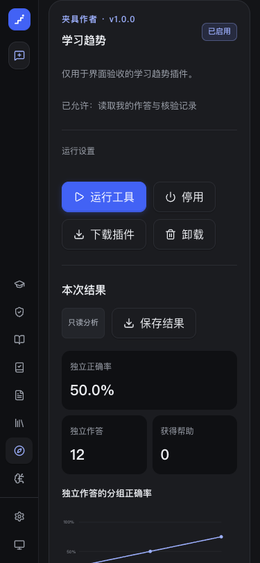
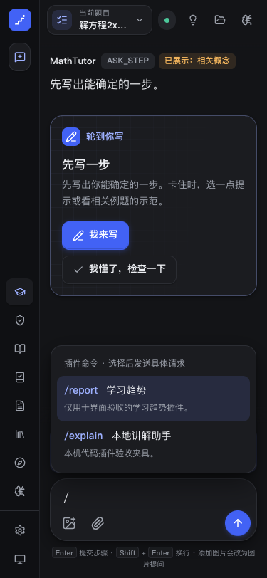

# 社区资源与教学插件

沿用 MASTER 的纸墨、冷蓝、系统中文字体与 Lucide 图标。社区页新增独立功能结构，不改全局视觉语言。

## 信息与交互

- 文件导入：普通社区仅接收用户自己的文件；“发现资源”接收文件夹、Markdown、TXT 或题库，“我的插件”独立接收插件。不展示推荐、收藏或资源来源目录。完整性检查在内部完成，失败不伪造成功收据。
- 我的插件：安装与授权分开，默认停用，展示可读权限列表与“同意并启用”；配置、运行、升级、停用、卸载和“保存结果”可实际操作，结果保存为可阅读文本。读取失败清掉旧启用卡片，先重新读取再允许运行。
- 代码插件：限定 Python、TypeScript 与代码 ZIP，单独呈现本地代码信任、运行时状态和真实执行结果。对话输入 `/` 提供键盘候选，完整命令通过聊天一次发送，由宿主执行；结果不计作学生作答。
- 创建、打包和目录集成放入开发者文档，普通页面不展示分享入口、SDK、工具参数或目录授权。
- 标题下功能区上移，移除旧分割线与导航间的大段留白；保持16–24px的紧凑间距。

## 布局与可访问性

- “发现资源”仅导入与展示个人资料，“我的插件”使用独立导入按钮；分享和来源旧链接回到资料页。状态允许换行，窄屏不依赖横向滚动。
- 导入、刷新和错误重试有键盘入口；按钮均有可访问名称。
- 插件曲线保留所有真实数据点，横轴最多八个刻度，另有完整数据表。独立作答、帮助后和自述分别显示；缺失值为 null / 空态，不能绘成 0% 或 100%。
- 侧栏导航可纵向滚动，在小屏横屏仍能到达全部入口。社区样式独立命名空间，主题和减少动画沿用全局令牌。

## 设计依据与验证

ui-ux-pro-max 的新页查询匹配 Minimalism & Swiss Style；返回的营销 Hero、紫色与英文字体不符合当前学习工作台，因此未采用。针对 `filter search catalog --domain ux`，采用真实匹配的空结果恢复建议和筛选标签换行；React/Next.js 按当前安装文档实现客户端状态与深链接。

前端 244 项通过，生产编译通过；生产 standalone 的 `smoke-community.mjs`、`smoke-learning-support.mjs`、`smoke-creator-workspace.mjs`、`smoke-vault-files.mjs` 全部通过。覆盖桌面、375px、横屏、夜读、减少动画、版本锁、升级权限、无数据与真实序列、导出、旧目录与创作链接回到导入页、代码信任、命令键盘选择和插件服务失败恢复。

后端回归覆盖独立资料与插件导入、打包互通、严格元数据、跨用户、Origin、重试、失败补偿、真实 Python/TypeScript 进程和斜杠命令回执。真实题库、SQLite、学习事件和文件读写另有集成测试；具体数量与产物结果以本次提交的测试及安装包验收记录为准。浏览器使用隔离夹具，以下截图不代表学生真实数据、社区用户规模或教学质量分数；本轮无付费模型调用。

