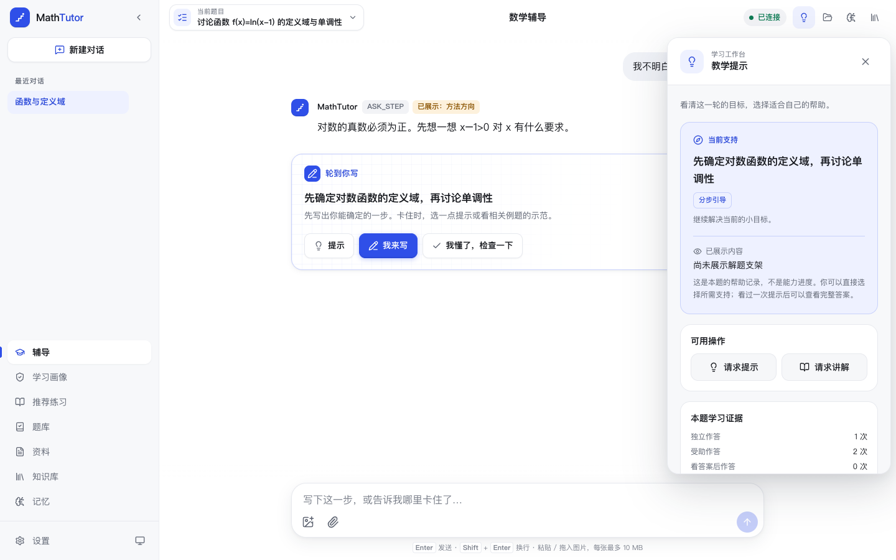
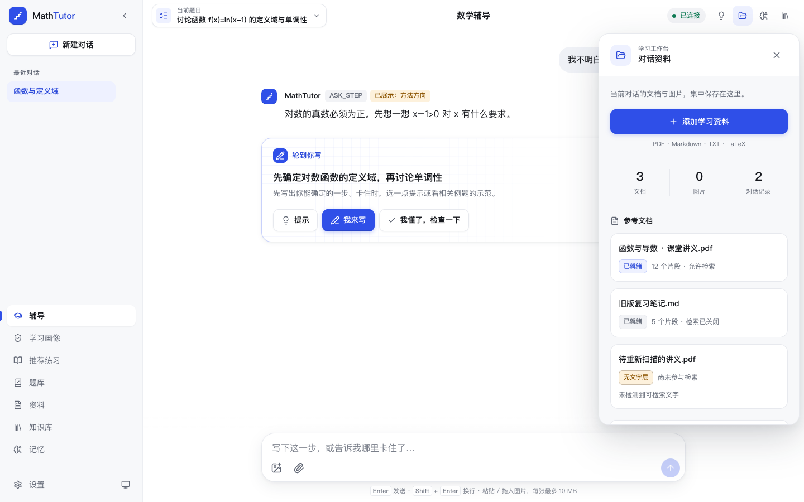
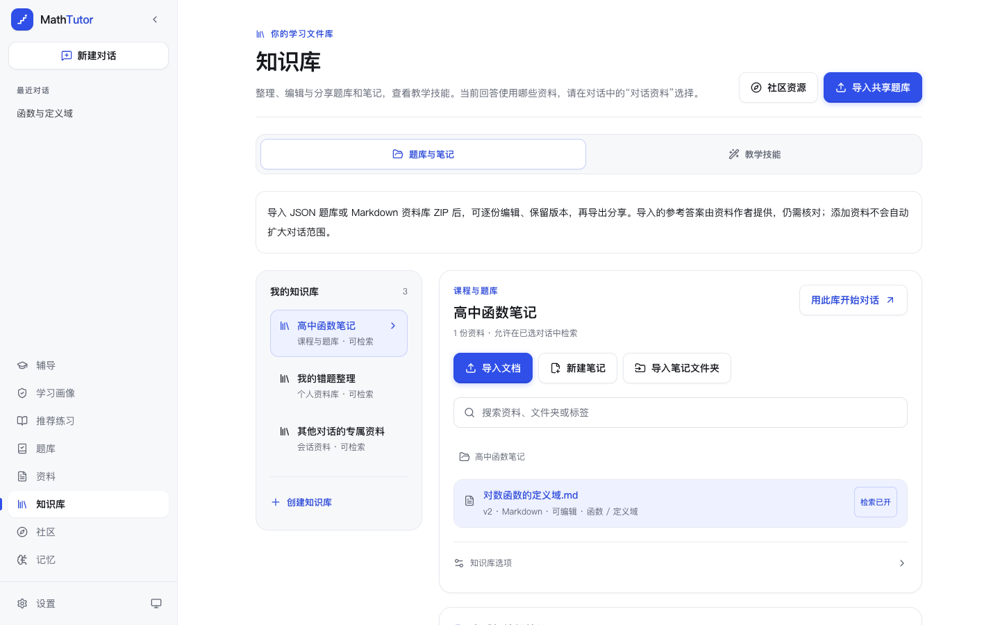
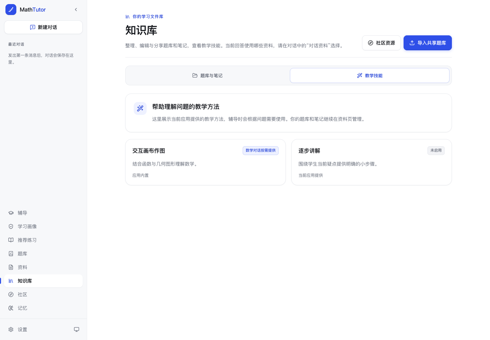
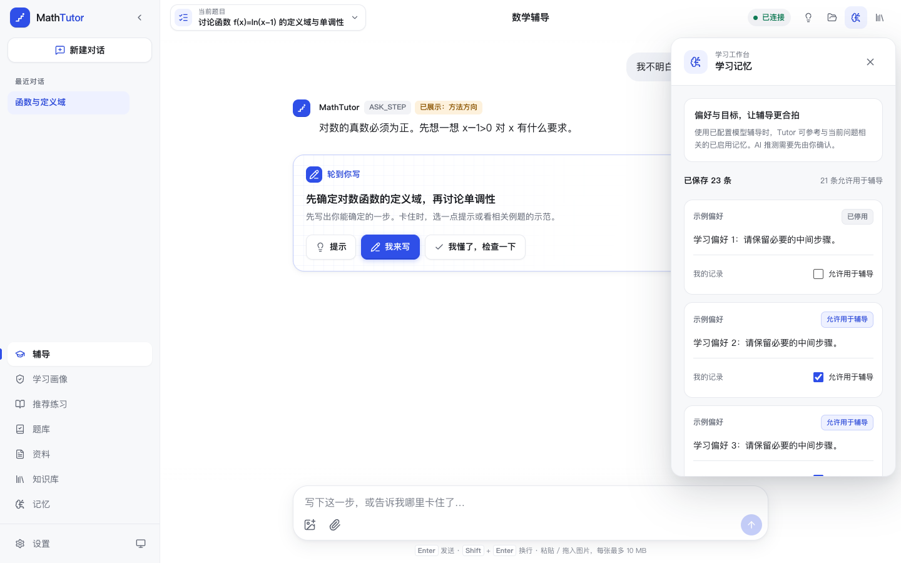
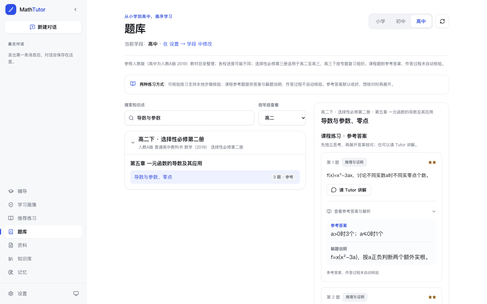

# 教学提示、对话资料与知识库

本页是既有 `MASTER.md` 的学习支持页面补充，保留纸墨、冷蓝、语义颜色、Lucide 图标及离线系统字体。

## 信息层级

- 教学提示：本轮目标与支持策略在冷蓝目标卡中呈现；可用操作、可跳过的诊断、真实作答证据按任务分组。已展示内容描述帮助记录，不显示能力进度或虚构分数。
- 对话资料：添加资料、库存与当前回答参考范围集中在同一面板。库与文档先在草案中选择，预览实际生效来源后显式应用；面板关闭及本次运行中返回页面保留草案，跨会话隔离。加载失败不伪造默认值，保存后重新读取确认，未确认时阻止发送。扫描件、解析失败、已停用与已就绪不混为同一种状态。资料导出保留完整库存及单独的范围清单。
- 学习记忆：完整列出保存的条目，展示 `object_json` 正文、来源、启用开关和待确认操作；旧的谓词正文记录仍可读。启用表示允许相关时参考，不声称本轮已使用，也不等同于掌握度。未确认 AI 推测不参与回答，离线基础辅导暂不按任意文字偏好调整。
- 知识库：题库与笔记、教学技能两个入口；题库按文件夹与面包屑浏览，搜索可跨文件夹，Markdown 位置可编辑。相同正文的别名明确提示共享正文、版本与检索状态，移动只影响打开的位置。共享题库 JSON 或 Markdown ZIP 导入新库，编辑后可回导出；导入不自动挂载到对话。
- 教学技能：只展示服务端真实教学方法与启用状态。扩展、文件授权、工具参数与 SDK 用法集中在开发者文档中，知识库不展示能力扩展入口或接口卡片。

## 交互与布局

- 删除顶栏重复的“收起右侧工具”按钮。原工具按钮仍可切换或关闭，面板保留带可访问名称的关闭按钮与 Escape。
- 打开面板将焦点移至面板标题；显式关闭返回原触发器。它是非模态辅助面板，不设置错误的对话框角色、不锁住键盘焦点。
- 工具面板常规宽 360px，在工作区宽不超过 1200px 时浮于右侧。浮层底部按输入组件实际高度留空，内容独立滚动。若键盘焦点移到面板外并被浮层遮住，自动关闭浮层且保留新焦点。
- 知识库在桌面使用库列表 / 文件夹与编辑器双栏；800px 以下顺序排成单列。范围只在对话资料内展示，避免两个入口修改同一个会话设置。标签与资料名允许换行，来源哈希与笔记正文不会撑出容器。
- 图标按钮均有名称、装饰图标隐藏于辅助技术。颜色只传达有文字说明的状态；各主题沿用语义令牌，减少动画偏好沿用全局规则。

## 依据与验证

- 已读 ui-ux-pro-max、其 `quick-reference.md` 与 `pro-rules.md`，以及当前安装 Next.js 的 Client Components、CSS 与 accessibility 文档。
- `progressive disclosure` 的数据库查询两次误命中标题换行，不将该结果作为面板设计依据；此项使用内置优先级规则。`component state --stack react` 命中局部状态及用户行为测试规则。
- `focus not obscured --domain ux` 命中 Web 焦点不被覆盖规范，由主代理复核后采用。
- 验证命令：`cd web && npm test`，`cd web && npm run build`；真实浏览器行为与布局检查为 `node scripts/smoke-learning-support.mjs`、`node scripts/smoke-workspace-layout.mjs`（启动隔离端口的开发服务后运行）。
- 浏览器测试使用模拟资料、记忆、知识库和会话，不读取用户数据、不调用模型；实际记忆进入模型提示的验证由后端独立测试负责。

## 0.6.5 验收记录（2026-10-16）

- 后端完整回归：2760 通过、11 跳过；记忆接入不改变检索策略矩阵的适用范围。首次全量检查发现的策略范围引用问题已通过独立的记忆读取入口修复，并重新完成整套回归。
- 前端：217 通过；生产编译、TypeScript 与静态页面生成通过。桌面源码契约：48 通过、2 个产物级检查跳过，界面开发阶段未构建安装包或运行 Windows CI；0.6.5 发布阶段的打包验收另见[发布说明](../../../docs/RELEASE_0.6.5.md)。
- 三套真实 Chrome 检查通过：`smoke-workspace-layout.mjs`、`smoke-learning-support.mjs`、`smoke-question-bank.mjs`。后两者使用生产 standalone 前端，覆盖 375px、桌面、横屏、夜读、减少动画、23 条记忆完整展示及开关确认、范围保存/离开取消、年级筛选、默认隐藏答案，以及只发送题干的讲解入口。
- 题库页面夹具直接从当前 `QuestionBankService` 导出，不手工重写课程题或答案。可设置 `MATHTUTOR_TEST_PYTHON` 指向项目 Python，`PLAYWRIGHT_MODULE` / `CHROME_EXECUTABLE` 指向已有浏览器运行时；`LAYOUT_URL` 可指定隔离的前端端口。
- 题库的数量、独立数学复核与自动核验边界见[课程覆盖报告](../../../docs/QUESTION_BANK_COVERAGE.md)；学习记忆的真实 API / SQLite / WebSocket 证据见[记忆链路检查](../../../docs/LEARNING_MEMORY_AUDIT_20261016.md)。本轮没有模型调用或基准成绩变更。

## 资料库与开发接口验证

`smoke-creator-workspace.mjs` 验证知识库只展示资料和教学技能，旧扩展链接回到资料页，页面不发目录授权或工具管理请求，也不展示“返回对话”按钮。`smoke-vault-files.mjs` 与 `smoke-learning-support.mjs` 验证资料选择和文件编辑。浏览器夹具按真实 API 的 `provenance.relative_paths` 展开共享位置，覆盖只移动当前别名、正文和检索同步、导入时清空旧搜索、编辑后导出当前正文。

前端 244 项通过，生产编译通过；桌面源码契约与原生选择器 51 项通过、2 项需实际打包产物的检查留到安装包验收。四套 Chrome 检查在生产 standalone 前端全部通过，覆盖 375px、横屏、夜读、减少动画、知识库文件与教学技能；未调用付费模型。后端覆盖资料范围、TXT/文件夹导入、别名、版本和学习记忆，具体全量数量以本次提交的验证记录为准。

独立后端集成使用真实 SQLite、HTTP、WebSocket 与临时文件系统，模型传输使用本地桩，验证从模型可见 Schema 发现授权目录，再完成列目录、读取、写入与最终回复；同轮重新绑定也不能执行第四次文件操作。前后端行为测试不作为教学基准分数。

以下截图来自隔离测试资料，展示当前开发界面与交互，不是学生真实数据或模型质量评测。

### 教学提示

### 对话资料

### 知识库中的共享题库

### 教学技能

### 窄屏文件编辑

### 学习记忆与课程参考题

