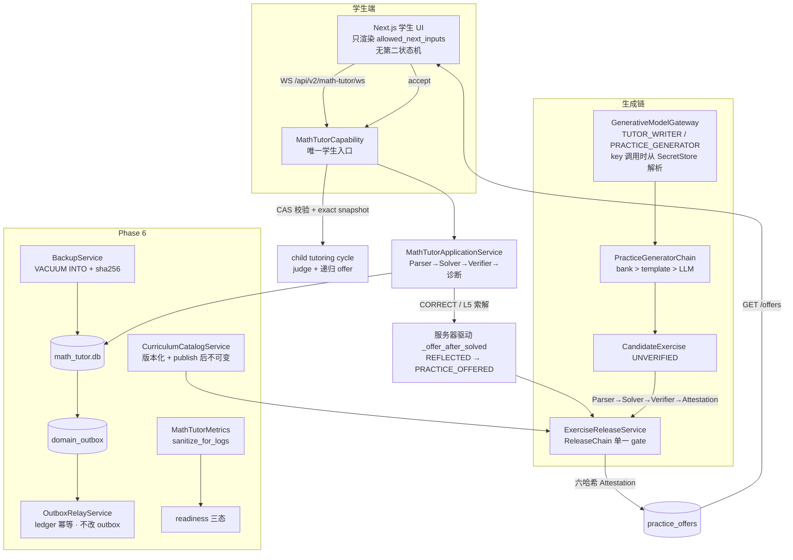
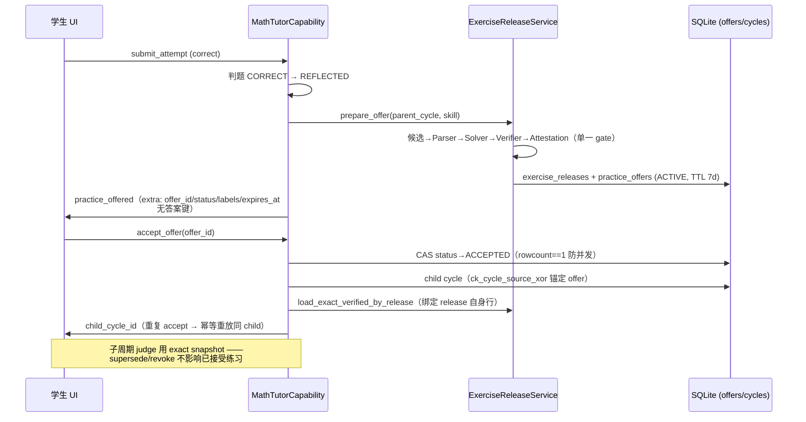
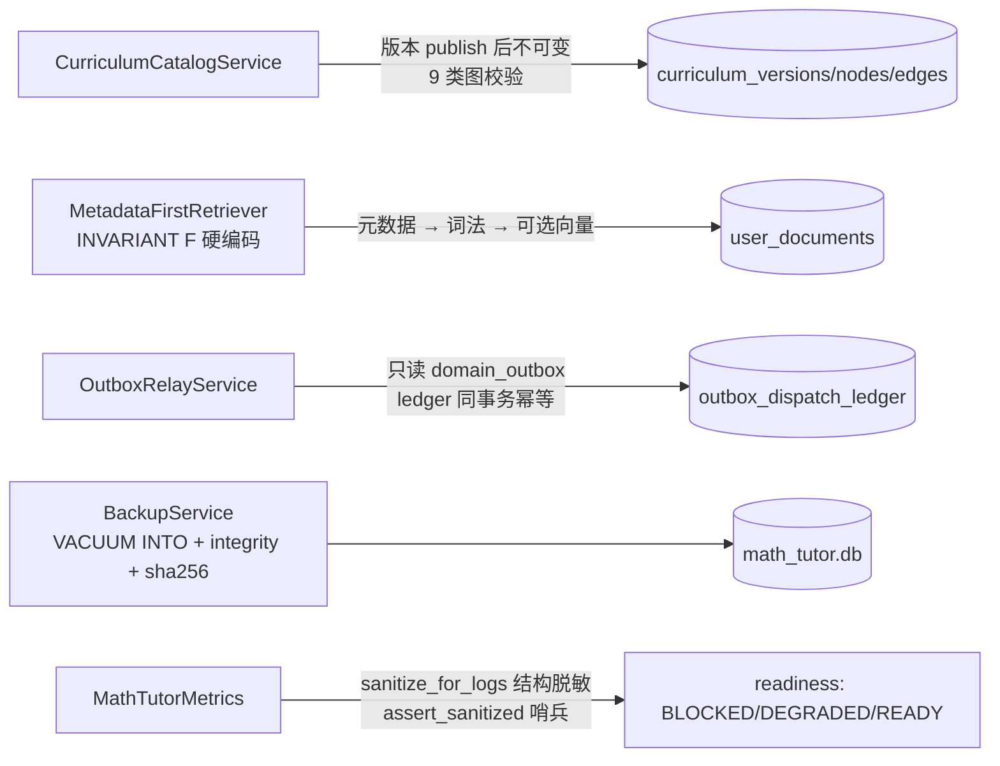

# K12 MathTutor 最终交付报告 — Phase 5 正式闭环 + Desktop 集成 + Phase 6 第一轮

> 项目：2026 福建省大学生计算科学与智能创新大赛 · K12 数学智能辅导系统
> 轮次：2026-08-20/21 · 规格 §21 格式（A–J）
> 代码：`DeepTutor/deeptutor/math_tutor/` + `desktop/` + `web/`
> 测试基线：**555 passed**（math_tutor）/ **132 passed + 1 skipped**（仓库级）/ **442 pass + 1 skip + 0 fail**（前端，tsc clean、build ✓）

---

## A. 执行摘要

三个 Wave 全部完成，独立审查（子代理 E）最终裁决 **PASS（无 P0–P2）**：

- **WAVE 1 — Phase 5 正式闭环**：LLMTutorWriter → GenerativeModelGateway 切换；LLM-backed CandidateExerciseGenerator；ExerciseRelease + Attestation（六哈希快照）；revoke/supersede；PracticeOffer + accept（CAS 防并发 + exact snapshot）；child TutoringCycle；**solve → 服务器驱动 offer → accept → child cycle → judge（绑定 release 快照）→ 递归 offer 的完整 E2E**
- **WAVE 2 — Desktop**：原生文件选择器（显式 pick，永不扫盘）+ Electron 锁定壳 + 模型配置 UI + KeychainSecretStore（OS 凭据库）+ Document/Memory 管理 UI + readiness 三态
- **WAVE 3 — Phase 6 第一轮**：Curriculum Versioning（publish 后不可变 + 9 类图校验）、metadata-first retrieval（INVARIANT F 硬编码）、Outbox Relay（幂等、不改 domain_outbox）、Backup（VACUUM INTO + 校验）、Observability（结构脱敏 + 三态就绪）

**PARTIAL / DEFERRED（如实记录，不冒充 DONE）**：sqlite-vec 向量 ANN = **PARTIAL → DEFERRED**（评估文档 `docs/PHASE6_SQLITE_VEC_EVALUATION.md`，目标机 ABI 未验证）；**Embedding Asset Distribution = DEFERRED**（规格不变式 G：禁止 bundled installer / first-run download / Ollama / ONNX / resource pack / remote embedding）；Reranker 真实现、outbox relay 定时循环 = DEFERRED（占位已就绪）。

---

## B. 交付范围与验收标准

| 规格要求 | 验收标准 | 结果 |
|---|---|---|
| Phase 5 闭环（§7.4/§7.5） | 候选 → Parser → Solver → Verifier → VerifiedSolutionRef → ExerciseRelease Attestation → PracticeOffer；accept 绑定 exact snapshot；幂等重放 | ✅ E2E 6 测试 + wire 契约修复 |
| Gateway 切换 | LLM writer 只在 GenerativeModelGateway fail-closed 时启用；TUTOR_WRITER / PRACTICE_GENERATOR 角色 | ✅ `build_tutor_writer` 三级检查 |
| Desktop（Wave 2） | 原生 picker 不扫描；密钥只进 SecretStore/OS 凭据库；壳锁定 | ✅ 静态断言 + Keychain + contextIsolation/sandbox |
| Phase 6 第一轮（Wave 3） | 课程版本化 + 图校验；metadata-first 检索；outbox relay 幂等；备份 WAL 安全；可观测性消毒 | ✅ 17 测试 + 2 接线测试 |
| 不变量 A–G | 逐字保持 | ✅ E 审计逐条 PASS（见 §G） |
| 真实测试数字 | 实际命令验证 passed/failed/skipped | ✅ 见 §H |

---

## C. 架构总览



**不变量保持**：LLM 永不签发 release / 修改 mastery / 决定状态转移（A）；offer 只能出自 ReleaseGate（B）；accept 绑定 exact snapshot（C）；Student Model 权威只读（D）；LLM consumer 只拿三类 Context（E）；retrieval_enabled=false 绝对拿不到（F）；Embedding 分发 DEFERRED（G）。

---

## D. Phase 5 正式闭环



**FAIL 条件审计（E，全部 PASS）**：F1 无 candidate→offer 直通（唯一构造点）；F2 attestation 只由仓库事务基于 VERIFIED 签发；F3 子周期强制 exact verified 字节，缺失即 fail-closed；F4 release 行除 status 翻转外无 UPDATE；F5 stale/revoked 拒绝（应用层检查 + SQL CAS 双重门）；F6 学生事件零答案字节（FORBIDDEN_STUDENT_FIELDS + extra 白名单）；F7 UI 无第二状态机；F8 重复 accept 幂等重放。

---

## E. Desktop 集成

```mermaid
flowchart LR
    subgraph Electron 壳
        WIN[BrowserWindow<br/>contextIsolation + sandbox<br/>webSecurity · nodeIntegration off]
        PRE[preload 仅 {isDesktop, platform}]
    end
    WIN -->|loopback| BE[Python product service<br/>MATHTUTOR_DESKTOP=1]
    BE --> SRT[SecretStore 决策<br/>桌面生产 → Keychain 单实例]
    BE --> PICK[/NativeDesktopFilePicker<br/>显式单文件 永不扫盘/]
    SRT --> GW[GenerativeModelGateway<br/>key 调用时解析]
    BE --> API[/api/v2/math-tutor/desktop<br/>settings/documents/memory/readiness/]
    API -->|mask 尾 4 位| UI[配置/文档/记忆 UI]
```

- KeychainSecretStore：macOS `security` / Linux `secret-tool`（**stdin 传值，永不 argv**）；Windows PARTIAL（raise 不降级）；fail-closed
- 审计修复：`_default_secret_store()` 下沉 ProductState——设置面与 gateway 共享同一 store 实例（key 进 Keychain 后生成时必可解析）
- 文档：retrieval_enabled 数据层门 + chunk 投影上限（≤8×600 字符），不默认全量上传

---

## F. Phase 6 第一轮



- 课程：publish 后写拒绝（VersionImmutableError）、re-publish 幂等、mapping id 与练习侧一致
- Relay：绝不 DELETE/UPDATE domain_outbox；ledger 4-tuple 唯一键 → 重放/重启幂等；sink 失败记录 attempts/last_error 不阻塞批次；日志白名单摘要无 payload 原文
- 备份：VACUUM INTO（绝不 cp 活跃 WAL）+ 双向校验 + 清单哈希，restore fail-closed
- 可观测性：键固定 allowlist + 敏感键结构脱敏（api_key/secret/reasoning/attestation/payload/document）+ 哨兵断言

---

## G. 安全与不变量验证

| 不变量 | 判定 | 证据（file:line） |
|---|---|---|
| A. LLM 永不判正确/签发/改 mastery/决定转移 | PASS | verifier 确定性（`practice_repository.py:38-60`）；状态机表（`state_machine.py:104-162`）；attestation 仅仓库事务签发 |
| B. 候选必过 ReleaseGate | PASS | 唯一 offer 构造点 = `prepare_offer` 在 `chain.release()` 后；LLM 候选同链（`llm_candidate_generator.py:305-341`） |
| C. accept 绑定 exact snapshot | PASS | `sqlite_practice.py:206-250` load_exact_verified_by_release |
| D. Student Model 权威 | PASS | memory/documents/curriculum/assembler 构造上无写路径；`_mastery_pairs` 只读归一化 |
| E. LLM 只拿三类 Context | PASS | writer 仅 PublicProblemView + DisclosedSolutionContext；生成器仅 PracticeGenerationContext 公开字段 |
| F. retrieval_enabled=false 绝对拿不到 | PASS | `retrieval_router.py:144-147` 硬编码 + 数据层 SQL 双门 |
| G. Embedding 分发 DEFERRED | PASS | 无 bundled installer/下载/Ollama/ONNX/远程 embedding 代码；仅 FakeBackend（sha256 确定性） |

**安全约束全部满足**：API Key 只进 SecretStore（绝不进 SQLite 业务表/学生事件/日志/错误消息/localStorage/普通配置 JSON）；学生产品无通用执行面（default deny 路由白名单）；不扫描磁盘（静态断言测试）；不默认全量上传文档给 LLM；学生 UI 不维护第二状态机；学生事件零答案字节。

---

## H. 测试结果（2026-08-21 实际命令）

```bash
# 1) math_tutor 全套（Phase 0–4 + 本轮）
python -m pytest deeptutor/math_tutor/tests -q
# → 555 passed, 315 warnings in 4.51s            [exit 0]

# 2) DeepTutor 既有套件（不回归）
python -m pytest tests/api/test_auth_*.py tests/runtime -q
# → 132 passed, 1 skipped, 1 warning in 1.21s    [exit 0]

# 3) 前端
cd web && npx tsc --noEmit && npm run build && npm run test:node
# → tsc 0 errors；build ✓ Compiled；
# → # tests 443 / # pass 442 / # fail 0 / # skipped 1   [exit 0]
```

本轮新增 112 个后端测试：Phase 5 闭环（release gate / offers / LLM 候选 / 6 E2E）、Desktop（Keychain 单实例等）、Phase 6（curriculum/outbox/backup/observability/router/wiring 共 19）、审计修复 +2。E 独立审查复核全部回归命令一致。

---

## I. PARTIAL / DEFERRED 清单（如实记录）

| 项 | 状态 | 说明 |
|---|---|---|
| sqlite-vec 向量 ANN | **PARTIAL → DEFERRED** | 评估完成（`docs/PHASE6_SQLITE_VEC_EVALUATION.md`）：本机 ABI 未验证；引入前保持 DocumentRepository 契约不变；当前词法 + 全量 cosine 融合对单学生规模够用 |
| Embedding Asset Distribution | **DEFERRED（规格不变式 G）** | 禁止 bundled installer / first-run download / Ollama / ONNX / resource pack / remote embedding；落地仅限新增 infrastructure 级 EmbeddingBackend 实现 |
| Reranker 真实现 | DEFERRED | NoOpReranker 占位（hook 在融合后、截断前） |
| Outbox relay 定时循环 | DEFERRED | 启动排空一次 + 手动 process_batch 已就绪；定时循环属第二轮 |
| Windows Keychain | PARTIAL | DPAPI 显式未实现（raise，不降级） |

---

## J. 结论与后续

**结论**：Phase 5 正式闭环、Desktop 集成、Phase 6 第一轮全部完成并通过独立审查；不变量 A–G 与全部安全约束保持；真实回归数字（555 / 132+1s / 442+1s-0f）由实际命令验证；PARTIAL/DEFERRED 如实记录。

**后续（下一轮）**：Phase 6 第二轮（sqlite-vec 目标机验证后引入、Reranker 实现、relay 定时循环）、生产部署（Nginx/Docker/备份策略）、Embedding 分发决策轮（在不变式 G 约束内选型）、非阻塞收尾清单（mastery_evidence 加 skill_id 列、attempt claims 序列化、L5 display_latex、文案学生友好化）。
