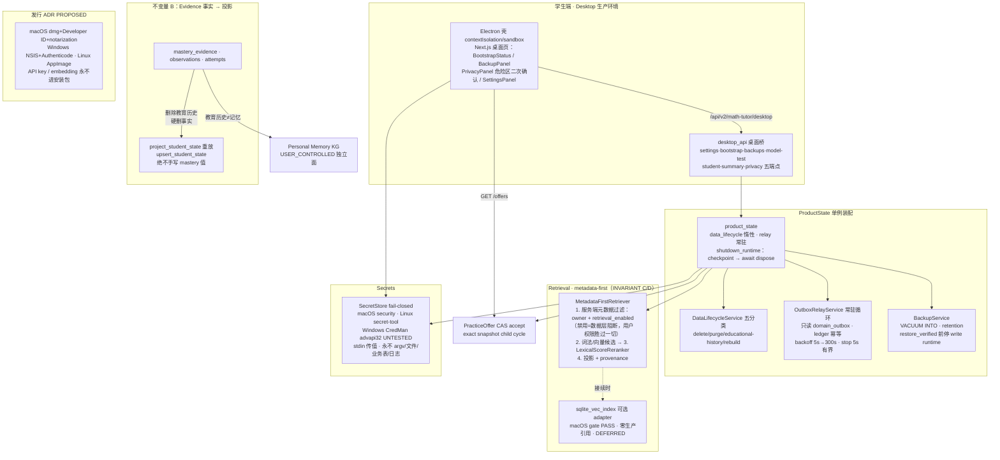

# K12 MathTutor 最终交付报告 — Phase 6 第二轮 + Desktop Production Readiness

> 项目：2026 福建省大学生计算科学与智能创新大赛 · K12 数学智能辅导系统
> 轮次：2026-08-21/22 · 多 agent 协作（MAIN 协调 + A Retrieval / B Outbox / C Desktop / D Privacy / E 终审）
> 代码：`DeepTutor/deeptutor/math_tutor/` + `desktop/`（Electron 33）+ `web/`（Next.js 16）
> 测试基线：**555 → 672 passed**（math_tutor）/ **158 passed + 1 skipped**（仓库级）/ **467 pass + 1 skip + 0 fail**（前端，tsc 0 errors、build ✓）/ **smoke-full 14/14**（macOS arm64 Electron E2E）

---

## A. Overall Result

**总裁决：PASS**（独立终审 E：23/23 FAIL 条件未触发，架构不变量 A–G 逐条 PASS，无 P0–P2）。

| 目标 | 裁决 | 说明 |
|---|---|---|
| ① Retrieval 质量与可部署性 | **PASS** | LexicalScoreReranker 落地 + benchmark 三链路冻结指标；sqlite-vec macOS arm64 gate 实测 PASS → 可选 adapter 落地，**生产接入 DEFERRED（按规格）** |
| ② Outbox Relay 常驻运行 | **PASS** | 常驻循环（有界 stop/backoff/ledger 幂等/poison 隔离），`_relay_wake` 提交加速；只读 domain_outbox |
| ③ Desktop 本地生产环境 | **PASS**（Windows **PARTIAL**） | bootstrap 九步骤 + backups 四端点 + restore 前停 write runtime + smoke 14/14；Windows Credential Manager 已实现但**未在目标机实测（UNTESTED，诚实标注）** |
| ④ SecretStore 跨平台 | **PASS**（Windows **PARTIAL**） | macOS security CLI / Linux secret-tool（stdin 传值永不 argv）/ Windows advapi32 Credential Manager（ctypes，UNTESTED）；任何异常 fail-closed，永不静默降级 InMemory |
| ⑤ 数据隐私/生命周期 | **PASS**（raw_text 加密 **PARTIAL**） | DataLifecycleService 五分类 + 删除教育历史=删事实重放投影（绝不手写 mastery）；导出白名单 fail-closed；加密 ADR：SQLCipher 推迟、自研加密否决、OS 全盘加密写入发行要求 |
| ⑥ 安全安装/升级/迁移/备份/恢复 | **PASS**（发行 **PROPOSED**） | BackupPolicy + restore_verified（双向校验/原子拷贝/恢复前停 write runtime）；发行 ADR PROPOSED（macOS dmg+notarization / Windows NSIS / Linux AppImage），诚实平台矩阵 |
| ⑦ 比赛 Demo E2E 与可观测性 | **PASS** | smoke-full 14/14（含 restart 五步）+ bootstrap 三态 + benchmark `-s` 打印指标 + 五类错误友好文案 |
| ⑧ 审计清理历史状态漂移 | **PASS** | 文档 reconciliation 全部落账（见 §H）；E 抽查确认 vault 与代码事实一致 |
| ⑨ Embedding 实现与分发 | **DEFERRED（按规格保持）** | 无任何冻结；仅协议/评估/可选 adapter；见 §J |

---

## B. Subagent Results

| 子代理 | 交付 | 测试 |
|---|---|---|
| **A — Retrieval** | sqlite-vec 第二轮实测 gate **PASS**（load_extension + vec_version + vec0 cosine KNN 全链路）→ 可选 adapter `infrastructure/sqlite_vec_index.py`（**零生产引用**，skipif 门控）；`application/lexical_reranker.py` LexicalScoreReranker（fuse 之后、截断之前）；`tests/test_phase6_retrieval_benchmark.py` 三链路 Recall@K/MRR/nDCG 冻结值断言 | +25（reranker 9 / metadata_first 10 / benchmark 6） |
| **B — Outbox / Reliability** | `application/outbox_relay.py` 常驻循环（start/stop 5s 有界/backoff 5s→300s/MAX_ATTEMPTS=20，只读 domain_outbox，ledger 同事务幂等）；`infrastructure/backup.py` BackupPolicy（retention + 原子 manifest）+ `restore_verified`（sha256+integrity+alembic 修订+拒绝活跃 -wal/-shm） | +26（relay_loop 11 / backup_policy 15） |
| **C — Desktop 生产化**（uiuxpromax-skill） | `infrastructure/keychain_secret_store.py` Windows Credential Manager（advapi32 ctypes，UNTESTED 诚实标注）；`api/desktop_api.py` bootstrap 九步骤（No API Key=DEGRADED、DB corrupt=BLOCKED）+ backups 四端点 + model-test 五类错误文案；Electron shell + 前端桌面页（BootstrapStatus/BackupPanel 二次确认/PrivacyPanel/WelcomePanel）；smoke-full 9/9 → 14/14 | 前端 442→464 |
| **D — Privacy / Data Lifecycle** | `application/data_lifecycle.py`（五类数据分类 31 表全覆盖 + delete/purge/rebuild + delete_educational_history 删事实→重放投影）+ `application/data_export.py`（EXPORT_ALLOWED_FIELDS 白名单 + validate_export fail-closed）+ `docs/ADR_DATA_LIFECYCLE_RAW_TEXT.md`（PARTIAL）+ `docs/ADR_DESKTOP_DISTRIBUTION.md`（PROPOSED） | +19（data_lifecycle） |
| **MAIN — 集成** | `api/product_state.py`（data_lifecycle 惰性属性 + relay 常驻接线 + `shutdown_runtime`：WAL checkpoint(TRUNCATE) → `await engine.dispose()` + backup trio）；`api/desktop_api.py` 隐私五端点（purge-documents / purge-memory / educational-history / rebuild-indexes / export）+ 既有 DELETE documents/memory 委托 lifecycle；路由清单 +5 精确断言；前端 5 客户端 fn + 危险区（三破坏操作全走 ConfirmableDelete 二次确认，mastery 只读） | +47（main_integration 26 / privacy_wiring 9 / product_wiring 2 / 路由+desktop_bridge 扩展 10） |
| **E — 终审** | 只读审 + 实跑：23/23 FAIL 条件未触发、不变量 A–G 逐条 PASS、Phase 5 回归 F1–F8 40 全绿、四组测试实跑复现、文档 reconciliation 抽查无虚报。无 P0–P2；5 条 P3（收掉 2：ADR backups 端点措辞、benchmark 打印） | 672 / 158+1s / 467+1s / 14/14 复现 |

---

## C. 架构总览（2026-08-22，Phase 6 第二轮后）

---

## D. Retrieval（sqlite-vec PASS / 生产 DEFERRED）

- **sqlite-vec 第二轮 gate：PASS（macOS arm64 实测）** —— `load_extension` + `vec_version()` + `vec0` cosine KNN 全链路跑通（`docs/PHASE6_SQLITE_VEC_EVALUATION.md` 第二轮实测段）；可选 adapter `infrastructure/sqlite_vec_index.py` 落地。**约束保持**：adapter 只持有 (id, vector) 对、无任何过滤逻辑（INVARIANT C/D）；全库零生产引用；测试 skipif 门控；**生产接入与 dylib 分发一起 DEFERRED**（D1）。
- **LexicalScoreReranker**（`application/lexical_reranker.py`）：确定性、零外部依赖、离线可用；插在向量 fuse 之后、截断之前；不改 RetrievedChunk 形状；provenance 标记。
- **Benchmark（真实数字，`pytest -s` 打印）**：
  - `lexical`：Recall@3/5、MRR@3/5、nDCG@3/5 = **1.0 × 6**
  - `lexical+vector`（FakeEmbeddingBackend 伪随机向量）= **(0.5, 0.785714, 0.380952, 0.452381, 0.428571, 0.561714)**
  - `lexical+vector+reranker`：**1.0 × 6**（Reranker 完全纠偏向量噪声）
  - 另断言：禁用文档/错 owner 文档在所有链路所有 query 贡献为零；同 pipeline 重复运行逐位相同。
- **metadata-first 硬不变量测试**（`test_phase6_retrieval_metadata_first.py`）：禁用源/错 owner 即使向量相似度最高也永不检索；空过滤不调 embedding。

---

## E. Outbox Relay（常驻）

- `OutboxRelayService`：**只 SELECT domain_outbox（绝不修改）**；ledger 同事务幂等（4-tuple 唯一键镜像 outbox）；失败隔离（attempts/last_error，poison 事件不阻塞批次）；重启安全（ledger watermark）。
- 常驻循环：`start`（幂等）/`stop(5s 有界 force-cancel)`/退避 5s→300s/`MAX_ATTEMPTS=20`；ProductState 经 `MathTutorUow(engine, on_commit=...)` 接线 `_relay_wake`（每次提交唤醒，idle poll 兜底）。
- `shutdown_runtime`：relay/scheduler 停 → `PRAGMA wal_checkpoint(TRUNCATE)` → `await uow.engine.dispose()`（await 形式）→ store engine 单独 dispose —— **关停不阻塞、恢复前必停写**（`test_phase6_main_integration.py` / `test_phase6_relay_loop.py` 覆盖）。

---

## F. Desktop 本地生产环境

- **bootstrap 九步骤**：check_data_root → database → migration → secret_store → document_storage → curriculum → retrieval → outbox → model_gateway；**No API Key = DEGRADED、DB corrupt = BLOCKED**；step detail 仅友好中文。
- **backups 四端点**：GET /backups、POST /backup、POST /backup/verify、POST /backup/restore；路径穿越防御（客户端路径校验 + 服务端相对名白名单）；restore 成功恒报 `restart_required: true`。
- **五类模型错误文案**：credential_invalid / network_unavailable / provider_unsupported / model_unavailable / gateway_disabled —— 永不渲染 traceback/Authorization/key 材料（前端测试断言）。
- **SecretStore 跨平台**：macOS `security`（stdin 传值）/ Linux `secret-tool` / **Windows Credential Manager（advapi32 ctypes，UNTESTED on real host）**；`_default_secret_store()` 单实例下沉 ProductState（设置面与 gateway 共享）；任何异常 fail-closed。
- **平台矩阵（诚实标注）**：macOS = **TESTED**（smoke-full 14/14：health、bootstrap DEGRADED 九步、cycle-solve、practice-offer、offers-list、offer-accept、child-cycle、child-judge、backups-list/create/verify、restart 五步）；Windows / Linux = **PARTIAL**（实现完整，无目标机实测）。

---

## G. Privacy / 数据生命周期

- **DataLifecycleService 五分类**：AUTHORITY_EDUCATIONAL / USER_CONTROLLED / DERIVED / SYSTEM / SECRET，31 表全覆盖（未知表 fail-closed）。
- **删除教育历史（不变量 B 落地）**：一短事务内按 FK 序硬删事实（mastery_evidence → misconception_observations → attempt_assessments → attempt-linked verification_logs → attempts → attempt_submissions）→ `load_evidence_for_student` + `project_student_state` 重放 → 删旧投影行 → `upsert_student_state`（insert 分支无 CAS）；**静态源码断言测试证明无 mastery 直接写入**；教育历史≠个人记忆（两类不同表面）；幂等；内存模式 409 fail-closed。
- **五隐私端点**：purge-documents / purge-memory（只清本学生，其他学生数据 untouched 有测试）/ educational-history / rebuild-indexes（无 backend → 诚实 `unavailable`）/ export。
- **导出白名单**：EXPORT_ALLOWED_FIELDS 分区白名单 + validate_export fail-closed；递归断言导出体无 attestation/hash/payload/raw_text/secret/storage_ref/reasoning/trace/vector。
- **前端危险区**：清空资料/清空记忆/删除学习记录全部走 `ConfirmableDelete` 两次确认；学生摘要严格只读（无 mastery 编辑入口）；导出 Blob 下载 `mathtutor-export-YYYY-MM-DD.json`。
- **加密 ADR（PARTIAL）**：SQLCipher 推迟（发行期再评估）/ 自研字段级加密否决 / **OS 全盘加密采用并写入发行部署要求**。
- **发行 ADR（PROPOSED）**：macOS dmg + Developer ID + notarization + Hardened Runtime；Windows NSIS + Authenticode；Linux AppImage/deb；electron-builder；**API key 永不进安装包、embedding 永不进包**。

---

## H. Documentation Reconciliation（修正清单）

| # | 位置 | 修正（CURRENT STATE vs HISTORICAL SNAPSHOT） |
|---|---|---|
| 1 | 开发记录 §3 架构图 | 五处 🚧 翻绿（Curriculum/StagePolicy/AttemptVerifier/Evidence/Practice）+ 加 CURRENT STATE 注记（历史 🚧 状态保留在注记中） |
| 2 | 开发记录 §4.5 | 环 B 内存态 / 环 C 待 Phase 4/5 的历史描述就地修正 + 历史快照注记（未覆盖当前事实） |
| 3 | 开发记录 §4.8 | 缺失项 11/12/13/15 → ✅（#14 CAS worker 保留为唯一未做项） |
| 4 | 开发记录 §9 | D2（sqlite-vec 可选 adapter + gate PASS + 生产 DEFERRED）、D3（Reranker 已实现）、D7（DataLifecycleService 已落地） |
| 5 | `desktop/ADR-DESKTOP.md` | v0.3.0 修订历史（Windows Credential Manager UNTESTED、SecretStore 单实例）；删过时项「MAIN 需要做一行接线」；backups 端点措辞「七→四」 |
| 6 | 开发记录 §1/§6/§7 + 新 §4.16 | 进度表加 Phase 6 第二轮行；测试覆盖头 555→672；下一步重写；本轮交付新章节 |
| 7 | `math_tutor 模块文件地图` v3→v4 | 127→159 .py、29→45 测试文件、465→672 测试、前端 12→30 文件；新增 data_lifecycle/data_export/lexical_reranker/sqlite_vec_index/privacy 五端点；§16 映射 +29–31 |
| 8 | 测试文件名对齐 | 任务书引用的 `test_practice_release.py`/`test_adaptive_practice_offers.py` 在仓库不存在（内容已并入 `test_phase5_practice.py`/`test_adaptive_practice.py`）——回归以真实文件名实跑 40 全绿，本报告如实记录 |

---

## I. Tests（真实数字，2026-08-22 实际命令）

| # | 命令 | 结果 |
|---|---|---|
| 1 | `python -m pytest deeptutor/math_tutor/tests -q` | **672 passed**（755 warnings，8.64s） |
| 2 | `python -m pytest tests/api/test_auth_*.py tests/api/test_cors_settings.py tests/api/test_codex_oauth_*.py tests/api/test_mcp_settings_auth.py tests/runtime -q` | **158 passed / 1 skipped**（仓库级 auth+runtime 基线；tests/api 全量另 6 个既有失败为 telegram 模块缺失的环境缺口，与本轮无关） |
| 3 | `cd web && npx tsc --noEmit` | **0 errors** |
| 4 | `cd web && npm run test:node` | **tests 468 / pass 467 / fail 0 / skipped 1**（skip = Dockerfile 存在性） |
| 5 | `cd web && npm run build` | **✓ Compiled** |
| 6 | `cd desktop && npm run smoke-full`（Electron E2E，macOS arm64） | **14/14**（含 restart 五步） |
| 7 | `python -m pytest deeptutor/math_tutor/tests/test_phase5_practice.py test_adaptive_practice.py test_phase5_e2e_offer_flow.py -q` | **40 passed**（Phase 5 回归 F1–F8） |
| 8 | `python -m pytest deeptutor/math_tutor/tests/test_phase6_retrieval_benchmark.py -q -s` | **6 passed** + 打印三链路指标（§D 数字） |

本轮新增测试分布：reranker 9 + metadata_first 10 + benchmark 6 + relay_loop 11 + backup_policy 15 + data_lifecycle 19 + privacy_wiring 9 + main_integration 26 + product_wiring 2 + 路由清单/desktop_bridge 扩展 10 = **+117（555 → 672）**；前端 442→467。

---

## J. Remaining Decisions（必列 DEFERRED）

| # | 决策 | 状态 | 落地约束 |
|---|---|---|---|
| 1 | **Embedding Model（模型选型）** | **DEFERRED**（规格要求，本轮未选） | 只能新增 infrastructure 级 backend（实现 EmbeddingBackend Protocol），domain/application 零改动；禁止冻结 sentence-transformers/ONNX/Ollama/捆绑模型 |
| 2 | **Embedding Asset Distribution（资产分发）** | **DEFERRED**（规格要求，本轮未定） | 禁止 bundled installer / first-run download / resource pack / remote embedding API；sqlite-vec dylib 分发随此决策定案（adapter 已就位） |
| 3 | sqlite-vec 生产接入 | DEFERRED（gate 已 PASS，adapter 已落地） | 分发策略定稿后：保持 DocumentRepository 契约不变，接线层显式传扩展路径 |
| 4 | Desktop 发行签名/公证 | PROPOSED（ADR 已备） | macOS Developer ID+notarization、Windows Authenticode；Windows Credential Manager 需目标机实测 |
| 5 | CAS worker 隔离进程 | 未做（§4.8 #14 唯一保留项） | verifier 后端独立可 kill 进程（禁网、typed AST、资源预算） |
| 6 | raw_text 加密 | PARTIAL（ADR：OS 全盘加密） | SQLCipher 发行期再评估；禁止自研密码学 |
| 7 | 非阻塞收尾 | 延续清单 | mastery_evidence 列补全、claims 序列化、domain MasteryEvidence 对齐 LearningEvidence、L5 display_latex、拒绝文案学生友好化 |

---

**Defense-ready 声明**：本报告所有数字均来自实际命令输出（§I）；PARTIAL/DEFERRED 均如实标注，未冒充 DONE；架构不变量 A–G 由独立终审（不参与实现）逐条验证并给出 file:line；文档 reconciliation 区分 CURRENT STATE 与 HISTORICAL SNAPSHOT。
