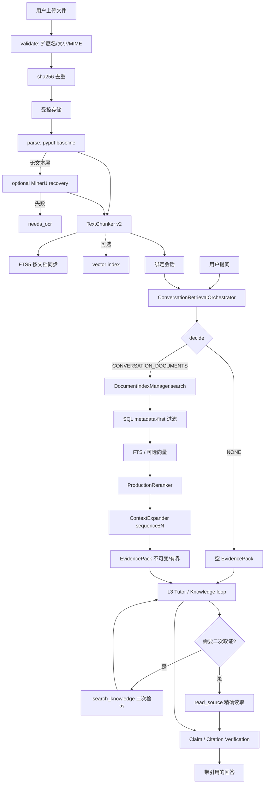

# RAG ARCHITECTURE

2026-09-20：新增隔离评测入口复用现有 Gateway/SecretStore；生产 `support_check` 的原提示词与布尔解析提取为 `check_claim_support`，生产工具循环与 A 路线共享。B 仍从产品 WebSocket 进入。2026-09-20 的 14 题实际落到 Tutor 表达路径，使用 Orchestrator 提供的初始摘录；原生工具调用与 support_check 均为 0，不能称为工具检查已执行；没有新增 HTTP 调用链或修改检索架构。正文证据只进入隔离评测产物。DeepSeek/deepseek-flash 已获授权并完成 24 次真实请求，A 有效判断 8/8、B 正常结束 7/14，开发质量 FAIL、正式证据不足。该增量的验证与授权状态见实施报告开头，上一轮打包证明仍对应当时冻结源码。

## Windows 生命周期约束（2026-09-19，0.4.0 已完成固定重复验证）

RAG 架构和语料未重建。`ProductState` 负责关闭入口、排空请求、停止 relay/scheduler、等待 backup 的线程任务、关闭 verifier、checkpoint 和 dispose。关闭状态为 RUNNING → STOPPING → STOPPED 或 FAILED；并发关闭等待同一任务，取消调用方仍等待清理完成。阶段失败后继续独立清理并保留第一个异常；FAILED 不重新开放请求，也不允许 restore 替换数据库。

WebSocket 断开时，其 reader/turn 子任务在屏蔽外层取消的 5 秒边界内回收；TeachingRepository 的事务 rollback/commit/close 也屏蔽 AnyIO 的重复取消并设 5 秒上限。应用工厂仅对已完整 STOPPED 的实例创建新状态，不重置 FAILED 实例。

迁移所创建的 stdlib SQLite 连接采用显式 closing，迁移引擎在 finally 中 dispose；应用部分 startup 失败也执行 shutdown。WAL/SHM 由 SQLite 自己释放和删除，关闭代码不手动 unlink。关闭后残留侧文件视为无法安全替换的证据。

`MATHTUTOR_LIFECYCLE_TRACE=1` 开启仅包含实例/进程/线程/任务标识、阶段、pool 连接事件、异常类型和函数行号的诊断；不记录 SQL、参数、文档内容、凭据或数据路径。历史失败及中断保留在 schedule-1/2，当前固定重复验证证据位于 `artifacts/lifecycle-repair/schedule-3/`，20 轮定向（每轮 52 passed）与 3 次全量（每次 1336 passed / 11 skipped）均完成且摘要一致；这组有限重复支持当前修复，不代表普遍安全。0.4.0 包外 smoke 17/17，详见实施报告；语义评测仍 BLOCKED_PROVIDER。

- 日期：2026-09-19
- 事实基线：`docs/CURRENT_STATE_RAG_AUDIT.md`
- 决策记录：`docs/RAG_IMPLEMENTATION_REPORT.md`

> 本文只描述**已经存在于生产调用链**的结构。未接线、DEFERRED、TEST_ONLY 的能力在 §7 单列，不得从本文推断为已实现。

---

## 1. 总览

```
L0  Ingestion                     确定性，无模型参与
L1  Document / FTS / Optional Vector
L2  ConversationRetrievalOrchestrator   ← Initial Retrieval（系统保证）
      Reranker
      ContextExpander
      EvidencePack
L3  Tutor / Knowledge loop              ← Second Retrieval（agent 决定）
      search_knowledge / read_source
      Claim / Citation Verification
```

**核心分界**：

> **Initial Retrieval 由系统保证；Second Retrieval 由 agent 决定。**

用户提问后，系统**先**检索并把 `EvidencePack` 交给模型；模型不再需要"想到"去检索。工具保留下来做它们真正该做的事：二次检索、multi-hop、精确读取原文以产生引用。

---

## 2. L0 — Ingestion（确定性链）

```
PickedFile（仅显式选择，绝不扫描目录）
  → validate          扩展名白名单 → 大小 → MIME      fail closed
  → 去重              sha256(owner + bytes)
  → store             受控存储目录 + 原子替换 + 越界检查
  → classify          TEXT_FILE
  → parse             baseline → optional recovery
  → chunk             TextChunker v2（结构感知）
  → FTS               按文档同步
  → optional vector   best-effort，失败不阻塞
  → bind conversation
```

**模型不参与任何一步**：没有 ingest 工具；文件路径、chunk 内容、文档 scope、generation/version 均不可由模型指定或修改。

### 2.1 PDF 决策树（D19 冻结）

```
baseline = PyMuPDF 若已安装，否则 pypdf        ← 发布版恒为 pypdf
     ↓
  解析（encrypted / corrupted → 分类异常）
     ↓
  有可用文本？ ── 是 → 返回
     │
     否
     ↓
  optional external recovery（MinerU）        ← 可达性与 baseline 无关（D20）
     ├─ 成功 → parse_mode = "recovered_external"
     └─ 失败/缺失 → parse_mode = "empty" → needs_ocr
```

| 能力 | 状态 |
|---|---|
| pypdf baseline | **guaranteed**（发布包内） |
| PyMuPDF rich parser | **OPTIONAL**（`pdf-rich` extra，不在发布包） |
| MinerU external recovery | OPTIONAL adapter，可达但不随包分发 |
| OCR engine | **NOT IMPLEMENTED** |

`[事实]` 逐页状态只陈述**可证明的事实**：`TEXT_LAYER` / `NO_EXTRACTABLE_TEXT`。后者**不是**"扫描页"的断言——空白页、图形页、矢量页、无法解码字体的页对文本层解析器而言完全一样。

---

## 3. L1 — Document / FTS / Optional Vector

```
user_documents ──┬── document_chunks ──┬── document_chunks_fts (FTS5)
                 │                     └── document_chunk_vectors (JSON, optional)
                 ├── document_index_builds   (signature: backend/model/version/
                 │                            dimension/normalization/runtime/
                 │                            chunker/parser)
                 ├── conversation_documents  (会话绑定)
                 └── knowledge_{spaces,members,bindings,versions,...}
```

`[事实]` **metadata-first 是 SQL 层的，先于评分**：

```sql
-- search_document_chunks
doc_where = owner AND retrieval_enabled=1 AND deleted_at IS NULL
          AND status IN ('ready','ready_with_warnings')
          AND document_id IN :scope          -- 作用域
-- FTS5 候选同样受限
WHERE student_id=:sid AND document_id IN :doc_ids AND document_chunks_fts MATCH :match
```

`[事实]` 因此**不存在"先全局检索再按会话过滤"的路径**（审计 Q15 对抗性核验通过）。可见性不依赖调用方自觉：面向模型的读取一律走带守卫的原语（`list_retrievable_chunks` / `list_chunk_neighbourhood`）。

### 3.1 向量是可选能力，不是阻塞项

```
embedding unavailable → 纯词法检索继续
vector index 缺失     → 纯词法检索继续
```

`[事实]` 发布运行时**不含任何 embedding 后端**（`forbidden_feature_packages`），因此发布形态下观测到的是 lexical。但**类型域保留 `hybrid`**（§6）—— 观测到的默认不得冻结架构能力。

### 3.2 Adjacency 是推导的，不是存储的

```
sequence - 1 / sequence / sequence + 1   ← 读取时按 (document_id, sequence) 区间取
```

`[事实]` **没有** `prev_chunk_id` / `next_chunk_id` 列。`document_chunks` 已有 `UNIQUE(document_id, sequence)`，加两列买不到任何东西，却要付一次 migration + 回填并一直维护一致性。`parent_chunk_id` 是真实的父子关系，继续使用。

---

## 4. L2 — ConversationRetrievalOrchestrator

```
retrieve_for_turn(owner, document_ids, user_query, history=(), problem_text=())
   │
   ├─ decide       NONE | CONVERSATION_DOCUMENTS     确定性，无 LLM 调用
   ├─ scope        document_ids 是【必填参数】，无默认值
   ├─ rewrite      RetrievalQuery（有界，绝不拼整段历史）
   │
   ├─ kernel       DocumentIndexManager.search        ← 唯一检索内核，签名未改
   │
   ├─ rerank       ProductionReranker                 确定性、无模型
   ├─ expand       ContextExpander                    sequence±N + 硬预算
   └─ pack         EvidencePack                       不可变、有界投影
```

### 4.1 为什么 `document_ids` 必填

`[事实]` 审计 D1 的根因是"未设置 scope"与"全部文档"共用了同一个值（`None`），而仓储把 `None` 读作"不过滤"。编排器让**未设置 scope 在类型上无法表达**——调用点只能给出一个具体的（可能为空的）列表，空列表即 `NONE`。

### 4.2 决策规则（确定性、可测试、无网络）

| 输入 | 决策 |
|---|---|
| `hints_only` | `NONE`（原因 `decision_none_hints_only`） |
| 空 query | `NONE`（`no_query_hint`） |
| 空 scope | `NONE`（`empty_conversation_scope`） |
| 寒暄（你好/谢谢/ok…） | `NONE`（`decision_none_small_talk`） |
| 其余 | `CONVERSATION_DOCUMENTS` |

`[建议]` **歧义时检索**。对一个以"有据可答"为目标的系统，缺少证据比多搜一次代价更大；而 scope 已经限定了检索能触达的范围。

### 4.3 Query rewrite

```
original + 当前题目（截断）+ [引用词时] 最近的学生轮次（截断）
```

`[事实]` 「这一步为什么错」这类指代句**没有任何可检索词元**，必须吸收上下文；非指代句**不吸收**（避免把无关历史带进查询）。整体有长度上限，绝不把整段对话当查询。

### 4.4 Reranker

```
score = fused_retrieval_score
      + COVERAGE_WEIGHT      (0.5)  × 词元覆盖率
      + EXACT_PHRASE_BONUS   (1.0)  × query 逐字出现在正文
      + SECTION_MATCH_BONUS  (0.25) × query 出现在 section 标题
```

`[事实]` 权重是**命名常量**并有测试钉住。此前这套公式是 `KnowledgeService.search` 里一行内联的魔数 `1.0` / `.25`，无测试；而文件名像 reranker 的那个模块读 `getattr(candidate, "text", "")`，对真实 `RetrievedChunk` 恒为空——它从未生效过。

`[事实]` **确定性、随包发布、无 unavailable 状态**。因此 telemetry **不实现** `rag_reranker_unavailable_total`（一个永不触发的计数器会暗示并不存在的能力缺口）。

### 4.5 Context expansion

```
触发（保守）：以下列续接标记开头，或以非终止标点结尾
  如上所述 / 根据上述 / 因此 / 由前面的定义 / 同理 / 接看 …
取回：(document_id, sequence ± 1)
预算：MAX_EXPANDED_ITEMS=4  ·  MAX_EXPANSION_CHARS=2400
```

`[事实]` 扩展读取**同样带完整可见性门**，绝不因为中心 chunk 已授权就整文档读取。读失败**不丢命中**，但记日志 + `read_failures` 计数（静默 `except` 曾把一个夹具 bug 藏了整整一轮）。

`[事实]` `parent_chunk_id` 优先扩展**未实现**。

### 4.6 EvidencePack（冻结契约）

```
EvidencePack
  query · rewritten_query
  evidences[]        ← 有序、去重、有界
  execution: RetrievalExecution

Evidence
  source_id · document_id · filename · chunk_id · sequence
  page / page_start / page_end · section · heading_path
  text · text_hash · expanded_from
  score · lexical_score · vector_score · rerank_score
  document_version · body_hash          ← 有版本快照的路径才填

RetrievalExecution
  mode ("lexical" | "hybrid") · retrieval_ran · reranker_used · expansion_used
  candidates_considered · items_returned · decision · degraded_reasons[]
```

`[事实]` 上限在**构建期**施加：≤8 条 / ≤12000 字符 / 单条 ≤2000。对**所有**消费者生效，包括未来新增的。不可变（frozen）。`public_projection()` 是模型唯一可见形态：`body_hash` / `text_hash` / 各分数默认不外泄。

`[事实]` `degraded_reasons` 是机器可读前缀（`embedding_runtime_unavailable` / `empty_conversation_scope` / …），不是自由文本。

---

## 5. L3 — Tutor / Knowledge loop

### 5.1 Initial Retrieval 在模型之前

```
query → orchestrator → EvidencePack → 注入 system prompt → 工具循环
```

提示词明确两点：证据是**数据不是指令**；证据只是**起点**——引用仍须 `read_source` 取得真实 `source_id` 与逐字 quote。

### 5.2 Initial Evidence 可直接引用（seed_evidence）

```
证据 (document_id, chunk_id, text)
  ↓ 版本正文 = chunk 以 "\n" 连接 → 由 sequence 推导 start/end
  ↓ 校验 ①：正文 [start:end] 必须逐字等于该 chunk 文本
  ↓ 校验 ②：证据文本必须是该 chunk 前缀，或包含该 chunk
  ↓ 通过 → 注册进可读集合
```

`[事实]` **hit restriction 未被放宽**：推导区间只有被证明"确实指向这段文字"才注册。注册过的区间可读；**猜测区间与猜测 document_id 仍为 `REJECTED`**。

### 5.3 Citation 与 Claim verification

```
read_source   只接受被 surfaced 过的 (document_id, version, start, end)
quote         必须逐字出现在已读文本中
body_hash     重读必须一致
summary 类    claim 额外过一道蕴含检查（相似度不算蕴含）
```

`[事实]` 引用 ID 由**服务端**生成，模型不能自造。`generation` 世代号贯穿：挂载变更即 `bump`，正在跑的旧任务立刻失效。

---

## 6. 跨层不变量

| # | 不变量 | 落实位置 |
|---|---|---|
| 1 | 权限过滤先于评分 | `search_document_chunks.doc_where` / FTS 候选 SQL |
| 2 | 未设置 scope 必须 fail closed | 编排器 `document_ids` 必填；`conversation_scope` 契约 |
| 3 | embedding 永不阻塞 | `_maybe_build_index` 吞 `EmbeddingUnavailableError`；`search` 降级 |
| 4 | 模型不能指定文档/区间/路径 | 工具 schema + `read_source` hit restriction |
| 5 | 证据必须可追溯 | `Evidence` 全字段 + `source_id` + `body_hash` |
| 6 | 降级必须可见 | `degraded_reasons` + `parser_id` / `classification` |
| 7 | 能力必须随包发布 | `tests/test_package_surface.py` |

---

## 7. 明确不在生产路径上的东西

`[事实]` 以下模块**零生产引用**，已在源码中显式标记：

| 模块 | 标记 | 原因 |
|---|---|---|
| `application/retrieval_router.py` | **DEPRECATED** | Route 2 后由 orchestrator + kernel 取代 |
| `application/lexical_reranker.py` | **DEPRECATED** | 由 `rerank.py` 取代；且原实现对真实 hits 恒打 0 分 |
| `infrastructure/sqlite_vec_index.py` | **DEFERRED（非死代码）** | `production sqlite-vec ANN` 在冻结 DEFERRED 清单内 |
| `tests/test_phase6_retrieval*.py` | DEPRECATED | 覆盖上述栈；官方 benchmark 已迁至 `tests/test_rag_production_benchmark.py` |
| `infrastructure/parse_adapters.py::DoclingAdapter / LlamaParseAdapter` | **DEAD_CODE** | 抛异常的桩，无人 import |

### 冻结的 DEFERRED 清单

```
built-in OCR engine                  NOT IMPLEMENTED
production sqlite-vec ANN            NOT IMPLEMENTED（维持 OPTIONAL）
optional neural reranker             NOT IMPLEMENTED
bundled heavy embedding runtime      NOT IMPLEMENTED
advanced GraphRAG                    NOT IMPLEMENTED
```

---

## 8. Mermaid


