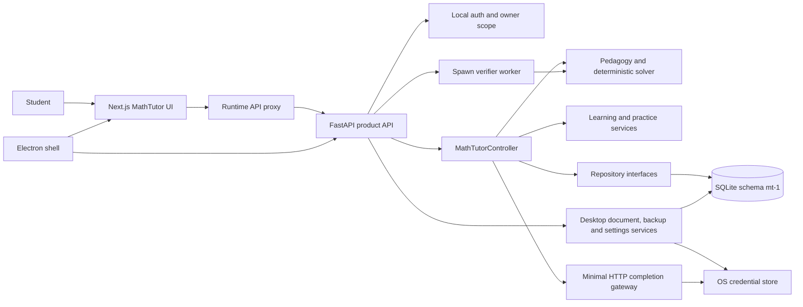

# Standalone MathTutor Architecture

Status: namespace/package checkpoint complete; final signed release review is
tracked separately. The only production Python package is `mathtutor`.

## Runtime topology

The Electron shell only launches the loopback backend/frontend, provides one
explicit native file picker, and hosts a sandboxed renderer. It does not own
tutoring logic, secrets, documents, memory, or API keys.

## Python/package boundary

- Distribution: `mathtutor` version `0.2.0`.
- Import root: `mathtutor` under `src/mathtutor`.
- Console entry: `mathtutor = mathtutor.standalone:main`.
- Product factories: `mathtutor.standalone:create_standalone_app` and
  `mathtutor.api.product_app:create_math_tutor_app_from_runtime`.
- Migrations and their Alembic template are package data. Migration `001`
  through `006` remain unchanged and are resolved relative to the installed
  package, not a checkout path.
- The desktop source allowlist stages only `python-app/mathtutor`; both the
  source and Python-runtime filters reject a `deeptutor` package.

The optional compatibility adapter remains in the old monorepo. Dependency
direction is adapter to standalone controller; the standalone project has no
reverse import.

## Configuration and mutable data

`MATHTUTOR_DATA_ROOT`, `MATHTUTOR_DB_PATH`, `MATHTUTOR_ENVIRONMENT`,
`MATHTUTOR_AUTH_ENABLED`, `MATHTUTOR_AUTH_SECRET`,
`MATHTUTOR_API_BASE_URL`, and `MATHTUTOR_PYTHON_RUNTIME` are authoritative.
Released `DEEPTUTOR_*` data/auth/environment aliases are accepted read-only for
one upgrade cycle and are marked deprecated in source. New launchers emit only
`MATHTUTOR_*` names.

All mutable state lives below the user data root: database, uploads, backups,
configuration, logs and the local auth store. Credentials remain in the OS
credential store; no browser storage or packaged file stores API keys.

## Frozen release contract

| Contract | Value |
|---|---|
| Application | `0.2.0` |
| Schema | `mt-1` |
| Migration head | `006` |
| Curriculum | `mt-curriculum-mvp-v1` |
| Verifier | `mt-verifier-v1` |
| Estimator | `mt-estimator-v1` |
| Parser | `mt-local-parser-v1` |
| Chunker | `mt-chunker-v1` |
| Retrieval | `mt-retrieval-policy-v1` |
| Practice release | `mt-release-policy-v1` |

Embedding distribution remains deferred. The default runtime continues to
degrade to lexical retrieval when a vector backend is unavailable.

## Security boundary

The product exposes only MathTutor HTTP/WS/auth/desktop routes. The WS envelope
is allowlisted and owner scope is created by local auth or the loopback-only
development identity. General chat, tools, agents, plugins, code execution,
MCP, notebook, search, research and generic product routes are absent from the
source/package allowlist and frontend route graph.
