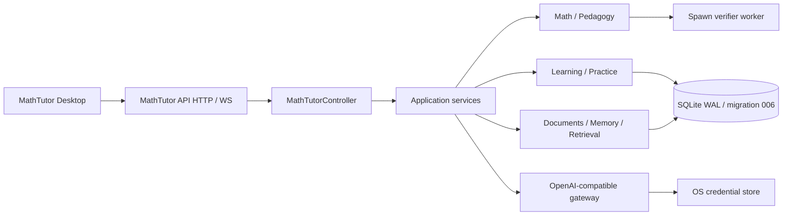

# Standalone MathTutor RC Report

Status: **STANDALONE RC READY — EXTERNAL DISTRIBUTION GATES PARTIAL**  
Date: 2026-08-28; auth hotfix candidate verified 2026-09-04

This report records the standalone extraction candidate after the ordered A-D
stages and Main regression. It does not turn an unsigned local artifact into a
publicly signed release. Independent review found no P0/P1 technical blocker;
the remaining distribution risks require external credentials or target machines.

## A. Overall

| Gate | Result |
|---|---|
| Repository extraction | PASS |
| External DeepTutor runtime dependencies | 0 |
| Production `deeptutor` imports | 0 |
| Clean wheel install without DeepTutor | PASS |
| Standalone behavior and data compatibility | PASS |
| Independent review | PASS (P0=0, P1=0 after freeze fixes) |

## B. Dependency census and replacements

The pre-extraction audit found 10 external DeepTutor runtime dependencies (11
source module spellings). They were replaced as follows:

| Old dependency | Replacement | Status |
|---|---|---|
| capability protocol/context | `MathTutorController` and typed request/event DTOs | CLOSED |
| generic `StreamBus` | MathTutor-owned `EventSink` and WS queue | CLOSED |
| generic auth/JWT/settings | `AuthProvider` / `LocalAuthProvider` and six local auth routes | CLOSED |
| multi-user current context | server-owned `PrincipalScope` / `StudentOwnerScope` | CLOSED |
| generic `LLMClient` type | local `CompletionClient` protocol and existing gateway | CLOSED |
| ChatOrchestrator/capability registry | direct API/WS to controller wiring | CLOSED |

The old-host adapter remains outside this repository. Dependency direction is
old host adapter to standalone controller, never standalone to old host.

## C. Repository and runtime architecture

The independent repository is rooted at `MathTutor/` and contains
`src/mathtutor`, `tests`, `web`, `desktop`, `resources`, `scripts`, and `docs`.
The detailed extraction inventory is in
`STANDALONE_EXTRACTION_MANIFEST.{md,json}`.

## D. Auth and owner isolation

`AuthProvider` is the boundary; Desktop uses `LocalAuthProvider`. The product
does not accept a client-owned `student_id`. Student/owner IDs, composite owner
foreign keys and owner-scoped repositories remain intact. Production auth-on
registration, login, cookie profile, authenticated WS and readiness passed in
the packaged app and readonly DMG flows. A real randomized Keychain sentinel
passed put/read/compare/delete/final-missing with no plaintext fallback or
secret in argv/log/config.

## E. Namespace and configuration

- Distribution and import package: `mathtutor` version `0.2.0`.
- Source root: `src/mathtutor`; `src/deeptutor` is absent.
- Production AST imports from `deeptutor`: 0.
- Runtime import tracing observed 108 modules, all `mathtutor.*`.
- `MATHTUTOR_*` is authoritative. Necessary `DEEPTUTOR_*` values are
  deprecated, read-only aliases for one upgrade cycle.
- The only legacy namespace use in the default product tree is the explicit
  pre-RC upgrade harness selecting `deeptutor.math_tutor` for the old artifact;
  it is not a production import or packaged runtime dependency.

## F. Persistence compatibility

Schema `mt-1`, migration head `006`, tables, hashes, IDs and all domain version
identifiers remain frozen. The real upgrade test mounted the frozen pre-RC DMG,
seeded a profile, document, Personal Memory, parent/child cycle, offer/release,
StudentState evidence and backup, then mounted the standalone DMG against the
same data root. Migration, document, memory, offer, cycles, exact verified
snapshot, backup verification and StudentState replay all passed.

## G. Test migration and regression

The 50 original Python specification files are all classified: 41 `MOVED`, 9
`COMPAT_ONLY`, zero silent removals. The seven migrated MathTutor frontend specs
plus the standalone auth regression spec collect 67 assertions. Full details
are in `TEST_MIGRATION_MATRIX.md`.

| Suite | Result |
|---|---|
| Original repo after decoupling | 709 passed |
| Standalone clean wheel backend | 571 passed, 749 warnings |
| Worker + backup/restore focused suite | 59 passed |
| Desktop Python contracts | 3 passed |
| Frontend Node | 67 passed |
| TypeScript | PASS |
| Next production build | PASS |
| Desktop Node contracts | 29 passed with final artifact enabled |
| Final artifact surface | 6 passed |
| Packaged app / readonly DMG | 17/17 each |
| Shared macOS public business smoke | 19/19 |
| No-API-key degraded smoke | 9/9 |
| Frozen pre-RC data upgrade | PASS |

Coverage includes Parser, Solver, Verifier, verifier worker isolation,
StagePolicy L0-L5, OutputGuard, attempt verification, LearningEvidence,
StudentState replay, practice release/offer/child cycle, curriculum, documents,
Personal Memory, lexical retrieval, outbox, backup/restore, privacy and no-key
operation.

## H. Desktop and package surface

The local unsigned macOS arm64 artifact is:

- `desktop/dist/MathTutor-0.2.0-mac-arm64.dmg`
- 180,747,880 bytes
- SHA-256 `fb9c3a247f9243fe27bafb728ef6892e4fe09f3ffaa328d9baa452e37ea479a5`

This candidate includes the standalone auth hotfix: browser auth requests use
the allowlisted `/api/v2/auth/*` routes, and the workspace waits for runtime
auth status before mounting. A clean first-user register/login flow and an
authenticated MathTutor WebSocket turn passed through the real frontend proxy.
The package also copies the standalone build's browser static directory
explicitly; app and readonly-DMG smoke fetched all 11 page-referenced JS/CSS
assets before continuing.

Readonly-DMG inventory: 8,864 regular files, 1,179 symlinks and 481,069,312
file bytes. The packaged Python application
contains only `mathtutor` and no `deeptutor` path. No product-level generic
chat, agent, research, tool/MCP, subagent, code-execution or shell route is
packaged or reachable from MathTutor. Third-party framework dependency closures
remain fully inventoried and may contain unrelated internal filenames such as
`agents`, `mcp` or `sandbox`; these are not MathTutor product surfaces.
Package-surface audit status is PASS.

Electron security remains `contextIsolation=true`, `sandbox=true`,
`nodeIntegration=false`, `webSecurity=true`. The native bridge remains limited
to the existing explicit picker, secret store, bootstrap, backup, restore and
settings surfaces.

## I. Old DeepTutor source

The standalone repository is the authoritative source. The old repository was
not destructively deleted in this extraction run: its retained source is marked
`MOVED_TO_STANDALONE` and non-authoritative. DeepTutor's compatibility adapter
now points one way to the installed standalone `mathtutor` controller; standalone
MathTutor never imports the old host. The historical tree is not installed,
imported or packaged by standalone MathTutor.

## J. Remaining external release risks

- Developer ID signing, notarization/stapling and Gatekeeper public-install
  validation require external Apple credentials and remain untested here.
- Windows x64 and Linux x64 target-machine packaging/smoke remain untested; the
  NSIS/AppImage configurations alone are not support claims.
- Embedding distribution remains PROPOSED / DEFERRED; no model or sqlite-vec
  production default was introduced.
- Existing FastAPI/Pytest deprecation warnings remain maintenance debt; they do
  not represent extraction test failures.
